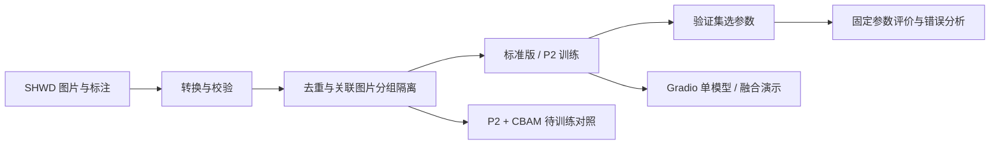

<div align="center">

# Helmet Detection Lab

**安全帽佩戴检测：从数据治理到小目标实验与交互演示**

YOLOv8 · P2 · SAHI · NMS / WBF · Gradio

[English](README_EN.md) · [快速体验](#快速体验) · [实验结果](#实验结果) · [文档导航](docs/README.md) · [反馈问题](https://github.com/CJ2323232/yolov8-learning/issues/new/choose)

</div>


*真实本地演示截图，展示历史版界面；不作为独立测试证据。新版代码支持标准版、P2、NMS/WBF融合四种方案。*

基于 **Ultralytics YOLOv8n 和 SHWD**，检测戴安全帽与未戴安全帽的**头部**。项目围绕一个问题展开：**如何减少小目标漏检，并用可信的评价衡量误检与速度代价？**

> **2026-10-25 状态：** 标准版/P2训练和融合评价已完成；P2＋CBAM结构、正式训练入口及67项固定参数检查已完成，**CBAM尚未训练，无精度提升结论**。公开下载权重目前仍为历史演示模型，新标准版/P2权重尚未发布。

## 值得看的四件事

| 工作 | 可验证结果 | 证据 |
| --- | --- | --- |
| **数据治理** | 7,507张有效图片；已检索关联的跨分区候选对20,466→0，491张调整分区 | [前后指标与核验](reports/scene_isolation/README.md) |
| **P2结构对照** | 同一511张验证集，本次最佳轮次mAP50–95：60.244%→61.301% | [原始曲线、参数与局限](reports/p2_training_comparison/README.md) |
| **融合与效率取舍** | NMS较P2少漏23个目标；CPU耗时约1.71倍 | [冻结阈值、分类结果与计时](reports/fusion_evaluation/README.md) |
| **可运行应用与新实验** | Gradio多方案切换；P2＋CBAM只增强P2检测分支，固定原训练参数 | [应用说明](docs/FUSION.md) · [CBAM训练](docs/P2_CBAM_TRAINING.md) |

候选对数不等于确认泄漏数。P2结果来自单次运行，标准版曾跨设备续训；以上证据不证明稳定的结构因果收益。项目贡献是问题分析、数据治理、实验设计与工程实现，基础网络和注意力机制来自已有工作。

## 快速体验

先体验已有的**历史演示权重**，无需训练或下载完整数据集：

```bash
git clone https://github.com/CJ2323232/yolov8-learning.git
cd yolov8-learning
python3 -m venv .venv
source .venv/bin/activate
python -m pip install -r requirements-gradio.txt
python download_weights.py
python app.py
```

Windows使用 `python -m venv .venv` 和 `.venv\Scripts\activate.bat` 创建、激活环境，之后执行同样的安装和启动步骤。

打开终端显示的本地地址，上传**没有检测框的原图**，点击“开始检测”。仅有历史权重时请选择“自选／历史演示模型”；标准版、P2和融合需要对应的两份新权重，不能用历史权重代替。完整路径与SHA256见[模型目录](models/README.md)。

| 你的目的 | 入口与当前可用范围 |
| --- | --- |
| 体验网页 | 上述命令；历史演示权重已公开，不对应下方新模型成绩 |
| 使用标准版/P2/融合 | [模型配置与加载](docs/FUSION.md)；需要尚未公开的两份新权重 |
| 查看实验是否可信 | [实验索引](reports/README.md)，包含原始记录、指标定义和限制 |
| 复现P2＋CBAM对照 | [训练与Windows迁移](docs/P2_CBAM_TRAINING.md)，需原隔离数据及预训练权重 |
| 理解代码 | [数据与模型流程](docs/WORKFLOW.md) · [CBAM逐段说明](docs/P2_CBAM.md) |

本地应用环境已验证：Python3.14.7 / torch2.14.0 / Ultralytics8.4.164 / Gradio6.30.0。正式CBAM对照沿用原Windows训练环境，不通过升级依赖改变条件。[复现范围与环境](docs/REPRODUCIBILITY.md)。

## 实验结果

**训练验证指标与固定阈值测试指标分别报告，不混为一张排行榜。**

| 同一验证集，最佳轮次 | 标准版 | P2 |
| --- | ---: | ---: |
| mAP50 | 91.584% | 92.995% |
| mAP50–95 | 60.244% | 61.301% |
| 训练预算 / 最佳轮次 | 50轮 / 第40轮 | 50轮 / 第48轮 |

[完整训练对照](reports/p2_training_comparison/README.md)。标准版前13轮在MPS，随后CUDA续训；P2为CUDA，当前没有多随机种子稳定性证据。

**融合评价：** 511张验证图选阈值，冻结后评价508张测试图、4,875个标注目标。

| 方案 | 最终阈值 | Precision | Recall | F1 | CPU ms/图 |
| --- | ---: | ---: | ---: | ---: | ---: |
| 标准版 | 0.29 | 87.82% | 86.19% | 87.00% | 21.24 |
| P2 | 0.25 | 87.23% | 87.59% | 87.41% | 33.55 |
| NMS融合 | 0.30 | 87.51% | 88.06% | 87.78% | 57.44 |
| WBF融合 | 0.17 | 87.95% | 87.86% | 87.90% | 53.91 |

这些是同类别一对一IoU≥0.5的**固定阈值微平均指标，不是mAP**。NMS是测试前确定的主要融合比较；其F1增益95%重采样区间跨0，且安全帽类别精确率下降。测试图片此前已被项目使用，不能称为全新外部盲测。CPU耗时使用8线程、预热后24图两轮，包含解码/预测/融合，不含模型加载、绘图与网页，不代表GPU速度。

[协议与原始数值](reports/fusion_evaluation/README.md) · [SAHI对比：召回与误检代价](reports/sahi_evaluation.md) · [历史模型复评](reports/legacy_test_reassessment.md)

## 方法与数据流



类别为 `0: hat`＝戴帽头部，`1: person`＝未戴帽头部，**不是整个人体或人脸身份识别**。当前划分为6,488 / 511 / 508；已检索关联不再跨集合，但未证明所有同源关系都被发现。PartA教室来源全部在训练集，验证/测试不能说明新教室泛化。

## 失败案例与边界


模型可能把无人佩戴的安全帽当作戴帽头部。微小、模糊、遮挡目标仍会漏检；加SAHI或融合也可能增加未匹配预测。[失败案例](reports/failure_cases.md)保留这些问题，外部15张图片仅作定性展示，没有真值框，不报告其mAP。

## 当前进度

- [x] 数据审计、关联分组隔离与可追溯清单。
- [x] 标准版/P2训练、SAHI比较、融合阈值校准与CPU计时。
- [x] Gradio方案切换、权重校验与模型复用。
- [x] P2＋CBAM结构和固定参数训练/续训入口；36项本地相关测试通过。
- [ ] 发布新标准版/P2权重及完整下载校验路径。
- [ ] 在原游戏本环境训练P2＋CBAM，报告对照结果和失败情况。
- [ ] 新场景评价、多种子重复与CUDA效率测量。

[更新记录](CHANGELOG.md) · [贡献与实验提交要求](CONTRIBUTING.md) · [技术复盘](docs/PROJECT_STORY.md)

## 来源与致谢

基础模型：[Ultralytics](https://github.com/ultralytics/ultralytics)；数据：[SHWD](https://github.com/njvisionpower/Safety-Helmet-Wearing-Dataset)；切片：[SAHI](https://github.com/obss/sahi)；融合：[Weighted Boxes Fusion](https://github.com/ZFTurbo/Weighted-Boxes-Fusion)；注意力：[CBAM论文](https://openaccess.thecvf.com/content_ECCV_2018/html/Sanghyun_Woo_Convolutional_Block_Attention_ECCV_2018_paper.html)；界面：[Gradio](https://github.com/gradio-app/gradio)。

不打包原始训练数据；第三方代码、模型与图片保留各自许可和来源说明，见[第三方说明](THIRD_PARTY_NOTICES.md)。这是研究与学习项目，尚未验证用于实际安全管理。
