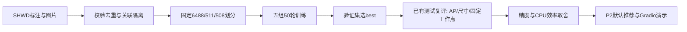

<div align="center">

# Helmet Detection Lab

**安全帽佩戴检测：数据治理、小目标结构对照与可解释的模型选择**

YOLOv8n · P2 · CBAM · SAHI · NMS / WBF · Gradio

[English](README_EN.md) · [快速体验](#快速体验) · [五组结果](#五组结构实验) · [最终评价](reports/final_evaluation/README.md) · [文档](docs/README.md)

</div>


*历史界面的真实截图，仅作演示。现有应用支持标准版、P2、NMS/WBF融合；新CBAM权重未自动替换应用默认。*

基于 **Ultralytics YOLOv8n 和 SHWD**，检测戴帽与未戴帽的**头部**。项目围绕三个问题展开：如何控制关联图片泄漏风险？P2对小目标是否有益？注意力或融合的收益是否值得误检和速度代价？

> **2026-10-28：五组50轮训练、统一测试、尺寸AP、固定工作点与完整本地图片处理计时均已完成。当前推荐P2单模型、conf=0.25。** P2＋P3 CBAM在原GPU测试AP上略高，但固定0.25时多出142个未匹配预测，F1下降1.023个百分点。全部五组、包括负结果均保留。
>
> **下载范围：** 公开下载仍为历史演示权重；本轮五组best.pt在本地完成校验，尚未发布下载。历史权重不能复现下表成绩。

## 值得看的工作

| 工作 | 可验证结果 | 证据 |
|---|---|---|
| 数据治理 | 7507张有效图；已检索跨分区候选对20466→0，491张调整分区 | [治理与限制](reports/scene_isolation/README.md) |
| P2与CBAM结构实验 | 五组50轮；两个新CBAM均接P3/64通道，保留旧P2位置组 | [五组与初始化记录](reports/final_evaluation/README.md) |
| 小目标评价 | 标准版→P2：小目标AP41.18%→43.12%，小安全帽AP37.47%→40.03% | [面积与微小头部](reports/final_evaluation/area_metrics.csv) |
| 系统取舍 | 同conf比较FP/FN/F1，5轮轮换计时；依据证据保留P2 | [最终选择](reports/final_evaluation/model_selection.json) |
| 应用与探索 | Gradio、权重校验与复用；SAHI、NMS/WBF对比保留 | [应用](docs/FUSION.md) · [历史融合](reports/fusion_evaluation/README.md) |

小目标AP为本轮COCO式bbox AP@300、原图面积<32²、IoU=.50:.95；不是所有小目标都改善。小于8px的139个安全帽中，P2匹配0个、标准版1个，极小目标仍是短板。候选对不是确认泄漏数，单种子结果也不证明稳定因果收益。

## 快速体验

无需训练，先使用已公开的历史演示权重：

```bash
git clone https://github.com/CJ2323232/yolov8-learning.git
cd yolov8-learning
python3 -m venv .venv
source .venv/bin/activate
python -m pip install -r requirements-gradio.txt
python download_weights.py
python app.py
```

Windows创建环境后使用 `.venv\Scripts\activate.bat` 激活，再执行同样的安装和启动命令。

上传**没有框和文字的原图**，选择“自选／历史演示模型”开始体验。标准版/P2及融合需要对应的新权重，不能用历史权重改名代替。见[模型与权重指纹](models/README.md)、[应用配置](docs/FUSION.md)、[复现范围](docs/REPRODUCIBILITY.md)。

## 五组结构实验

|模型|验证mAP50–95|原GPU测试mAP50–95|参数量|
|---|---|---|---|
|标准版|60.24%|57.57%|3011238|
|标准版+P3-CBAM|60.45%|57.56%|3011916|
|原始P2|61.30%|58.18%|2926824|
|P2+P3-CBAM|60.96%|58.41%|2927502|
|P2+P2-CBAM|60.80%|57.53%|2927084|

原GPU测试：同一508图、4875框，Ultralytics8.4.164、640、batch4、RTX3060、FP16、候选conf=.001；每组先用511张验证图选择best。新P3 CBAM均仅作用于Detect前的P3分支，新增678参数；旧P2分支CBAM为260参数。

训练沿用640、batch2、AdamW、lr0=.001667、lrf=.01、nbs64、seed0、50轮及原增强策略。**标准版配对的历史非预训练层初始化不完全一致，P2配对核验一致；不能称严格控制全部变量的二因素交互实验。** [详细条件](reports/final_evaluation/protocol.json)。

## 小目标到底是否受益

|模型|小目标AP50–95|小安全帽AP50–95|<16px安全帽匹配 /217|
|---|---|---|---|
|标准版|41.18%|37.47%|31|
|标准版+P3-CBAM|40.97%|37.13%|31|
|原始P2|43.12%|40.03%|35|
|P2+P3-CBAM|42.58%|38.78%|38|
|P2+P2-CBAM|42.54%|38.68%|33|

表中AP使用本轮统一CPU FP32预测与官方COCOeval，原图面积分组、maxDets300。<16px使用缩放到640后的GT短边，固定conf=.25、匹配IoU=.5，属于微小头部代理，不是实际距离。它与原图面积分组是不同定义。


P2对本批小目标有改善，但极小目标仍难检；P2＋P3 CBAM在微小安全帽累计组多匹配3个，却没有提高小安全帽AP。[完整小/中/大AP、Recall、类别与分母](reports/final_evaluation/README.md)。

## 同一工作点的系统表现

所有模型统一 **conf=.25、同类一对一IoU≥.5**；这是微平均P/R/F1，不是各模型最佳F1处的P/R，也不是mAP。

|模型|FP|FN|Precision|Recall|F1|核心CPU ms/图|
|---|---|---|---|---|---|---|
|标准版|700|620|85.87%|87.28%|86.57%|21.74|
|标准版+P3-CBAM|713|609|85.68%|87.51%|86.58%|22.42|
|原始P2|625|605|87.23%|87.59%|87.41%|32.80|
|P2+P3-CBAM|767|585|84.83%|88.00%|86.39%|33.36|
|P2+P2-CBAM|668|617|86.44%|87.34%|86.89%|33.47|

FP为相对已有标签的未匹配预测，可能含漏标。P2＋P3 CBAM相对P2少漏20个、未匹配预测多142个；其中戴帽头部多匹配2个、未匹配预测多45个。它的原GPU测试mAP50–95高0.228个百分点，不等于当前系统工作点更好。

核心CPU耗时包含读图、解码、预处理、网络、NMS、框取回及计数。本机Mac、FP32、batch1、实际8线程；32张验证图×5轮、模型顺序轮换、每模型160次。P2/P2＋P3 CBAM约32.80/33.36ms，含画框和PNG编码约69.49/69.95ms，**速度接近，不声称稳定速度优势**；不含加载、网页/网络或文件输出，不代表Windows CUDA速度。


**最终推荐P2：** 验证mAP最高、固定工作点F1最高、小目标AP优于标准版。标准版速度更快，可作资源受限备选。两种CBAM位置实验保留作消融与错误取舍证据；不删负结果，也不要求最终模型必须包含注意力。[选择依据与原始计时](reports/final_evaluation/README.md)。

## 数据与执行流程



`0: hat`是戴安全帽的头部；`1: person`是未戴帽头部，**不是整个人体**。PartA教室图片全部在训练集，现有验证/测试不证明新教室泛化。15张外部图仅定性展示。

## 复现与结论范围

- 五组均单种子、单次运行；不把50轮当50次重复，不把图像bootstrap当多种子证明。
- 测试集历史上多次使用，五组总分在本轮分层评价前已知；本轮先冻结规则再统计，仍不是新的外部盲测。
- 标准版配对初始化限制、旧/新CBAM位置与通道规模差异均保留。
- 共享工作点不代表每模型校准后的最优成绩；没有为了改变测试排名继续搜索阈值。
- CPU耗时受图像大小、目标数、首次绘图和后台负载影响；运行抖动不等于训练稳定性。

[最终实验与复现命令](reports/final_evaluation/README.md) · [五组逐轮数据](reports/final_evaluation/training_history.csv) · [历史SAHI](reports/sahi_evaluation.md) · [历史融合](reports/fusion_evaluation/README.md) · [代码流程](docs/WORKFLOW.md) · [简历与证据](docs/RESUME.md)

后续重点是公开新权重、干净环境复现、新场景评价；更强研究结论再考虑多种子。当前结构实验已收尾，无需继续堆模块。

## 来源与致谢

基础模型：[Ultralytics](https://github.com/ultralytics/ultralytics)；数据：[SHWD](https://github.com/njvisionpower/Safety-Helmet-Wearing-Dataset)；切片：[SAHI](https://github.com/obss/sahi)；融合：[WBF](https://github.com/ZFTurbo/Weighted-Boxes-Fusion)；注意力：[CBAM](https://openaccess.thecvf.com/content_ECCV_2018/html/Sanghyun_Woo_Convolutional_Block_Attention_ECCV_2018_paper.html)；评价：[COCO API](https://github.com/cocodataset/cocoapi)；界面：[Gradio](https://github.com/gradio-app/gradio)。

项目贡献为数据治理、实验设计、评价与工程集成，不宣称原创网络。第三方代码、模型和图片沿用各自许可与来源，见[第三方说明](THIRD_PARTY_NOTICES.md)。未验证用于实际安全管理。
