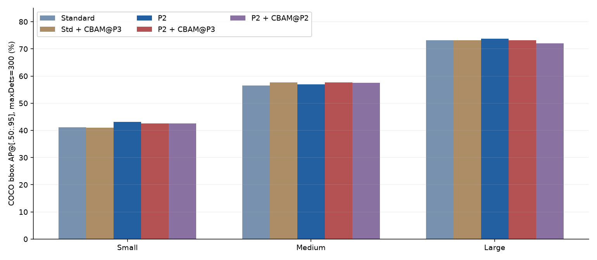
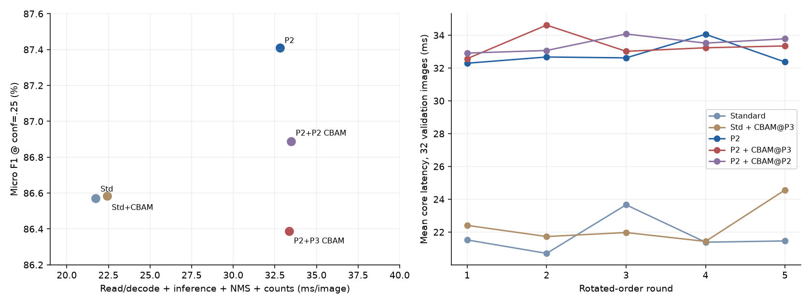

# Helmet Detection Lab

**Auditable helmet-wearing head detection with five structure experiments and explicit deployment tradeoffs.**

[中文](README.md) · [Full evaluation](reports/final_evaluation/README.md) · [Documentation](docs/README.md)


Built on Ultralytics YOLOv8n and SHWD. Classes are helmeted heads (`hat`) and bare heads (`person`), not full-body pedestrians. The contribution is data governance, experimental design, evaluation and engineering integration, not a novel backbone or attention mechanism.

**2026-10-28: all five 50-epoch runs, test evaluation, area-stratified AP, fixed-confidence errors and CPU timing are complete. Retain P2 at conf=.25 as the current recommendation.** Public downloads still provide only the historical demo checkpoint; the five new checkpoints are verified locally but are not yet published.

## Five-model results

|Model|Validation mAP50–95|Original GPU test mAP50–95|FP @.25|FN @.25|Micro F1 @.25|Core CPU ms|
|---|---|---|---|---|---|---|
|Standard|60.24%|57.57%|700|620|86.57%|21.74|
|Standard + CBAM@P3|60.45%|57.56%|713|609|86.58%|22.42|
|P2|61.30%|58.18%|625|605|87.41%|32.80|
|P2 + CBAM@P3|60.96%|58.41%|767|585|86.39%|33.36|
|P2 + CBAM@P2 (old)|60.80%|57.53%|668|617|86.89%|33.47|

Original GPU AP uses Ultralytics8.4.164, RTX3060, FP16, batch4 and the same508-image/4875-object test split; checkpoints were selected on511 validation images. Fixed-confidence columns are a separate CPU FP32, batch1 experiment, common conf=.25 and class-aware one-to-one IoU>=.5 matching. FP means unmatched predictions relative to existing labels and may include annotation omissions.

P2+CBAM@P3 gains0.228 percentage points in the original GPU test mAP50–95, but adds142 unmatched predictions for20 additional matches at the common operating point. Its microF1 drops1.023 points; helmet-specific unmatched predictions rise67→112 for only2 more matches. A small AP gain does not establish a better default system.

## Do small targets benefit?

Using official COCOeval bbox AP@[.50:.95], original-image area<32² and maxDets300:

- Small-object AP: Standard 41.18%, P2 43.12%.
- Small-helmet AP: Standard 37.47%, P2 40.03%.
- Helmet recall for GT short side<16px after scaling image long side to640: Standard 31/217, P2 35/217, P2+CBAM@P3 38/217.
- Below8px: Standard 1/139, P2 0/139, P2+CBAM@P3 4/139. Extremely tiny targets remain a major limitation.



These new area AP values use common CPU FP32 predictions and COCOeval; do not mix them with the original GPU/Ultralytics total AP. The short-side criterion is a tiny-target proxy, not a measured physical distance. The report retains all size/class denominators and negative outcomes.

## Efficiency and model choice

CPU core timing includes image read/decode, RGB conversion, preprocessing, forward, NMS, output transfer and class counts. SameMac, FP32, batch1, actual8 threads,32 validation images×5 rotated-order rounds,160 calls/model. P2/P2+CBAM@P3 average32.80/33.36ms; including drawing and in-memory PNG encoding69.49/69.95ms. Speeds are close; no meaningful speed or stability advantage is claimed. Model loading, browser/network and output-file writes are excluded; these are not CUDA figures.



P2 has the highest validation AP and fixed-point microF1, with improved small-object AP over Standard. Standard remains the faster resource-constrained option. Both CBAM placements and the SAHI/fusion experiments remain available, including failed tradeoffs. The application/model registry was not silently changed.

## Quick start

Run the published historical demo, which cannot reproduce the new model scores:

```bash
git clone https://github.com/CJ2323232/yolov8-learning.git
cd yolov8-learning
python3 -m venv .venv
source .venv/bin/activate
python -m pip install -r requirements-gradio.txt
python download_weights.py
python app.py
```

Windows: activate with `.venv\Scripts\activate.bat`. Upload an original image without prediction overlays and select the historical/custom preset. The new Standard/P2 and ensemble presets need their specific checkpoints. [Model availability](models/README.md).

## Reproducibility and limitations

- Fixed split:6488 train/511 validation/508 test. Retrieved cross-split candidate pairs20466→0 after491 assignment changes; candidates are not confirmed leaks or proof that all scene relations were found.
- Training:640,batch2,AdamW,lr0=.001667,lrf=.01,nbs64,seed0,50epochs, original augmentation settings. New CBAM modules both operate on P3 with64channels/678parameters; the old P2-position module has32channels/260parameters.
- Historical non-pretrained initialization differs for the Standard/Standard+CBAM pair; P2-pair initialization checks match. Do not claim a fully controlled two-factor interaction study.
- Single seed/run. Image bootstrap measures conditional sampling uncertainty, not training reproducibility. Runtime jitter is not training stability.
- The test set has been explored previously; overall five-model scores were known before this completion analysis. No new external blind evaluation or test-threshold sweep is claimed.
- AllPartA classrooms are training-only;15 external images lack complete labels. Neither supports unseen-classroom AP claims.
- Published process evidence is not a one-command fully reproducible experiment without the original data and unpublished checkpoints.

[Full report and commands](reports/final_evaluation/README.md) · [Machine-readable metrics](reports/final_evaluation/metrics.json) · [Frozen protocol](reports/final_evaluation/protocol.json) · [Raw timing](reports/final_evaluation/benchmark_raw.csv) · [Model selection](reports/final_evaluation/model_selection.json) · [SAHI](reports/sahi_evaluation.md) · [Fusion](reports/fusion_evaluation/README.md)

Next priorities are weight delivery, clean-environment reproduction and new-scene evaluation; repeated seeds only if stronger research conclusions are needed. No additional modules are required to close this project.

## Acknowledgements

[Ultralytics](https://github.com/ultralytics/ultralytics), [SHWD](https://github.com/njvisionpower/Safety-Helmet-Wearing-Dataset), [CBAM](https://openaccess.thecvf.com/content_ECCV_2018/html/Sanghyun_Woo_Convolutional_Block_Attention_ECCV_2018_paper.html), [SAHI](https://github.com/obss/sahi), [WBF](https://github.com/ZFTurbo/Weighted-Boxes-Fusion), [COCO API](https://github.com/cocodataset/cocoapi), [Gradio](https://github.com/gradio-app/gradio). See[third-party notices](THIRD_PARTY_NOTICES.md). Research/learning project, not validated for operational safety management.
