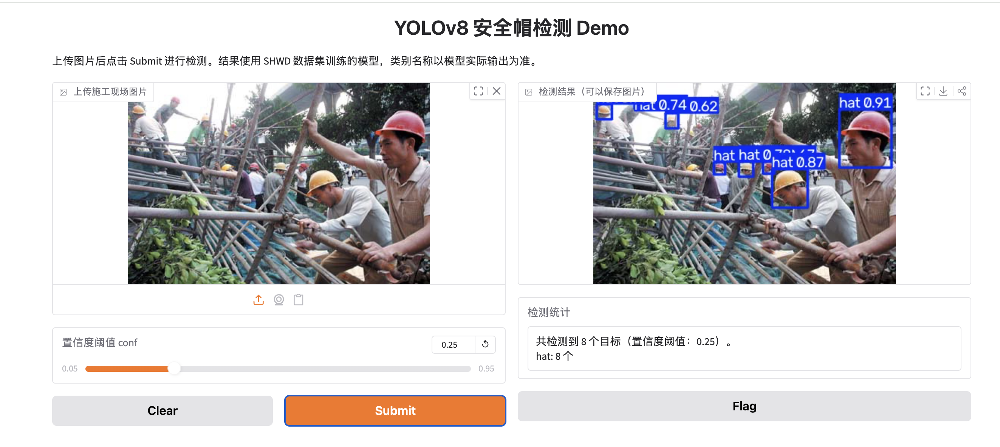
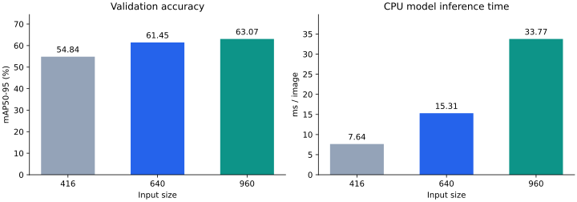
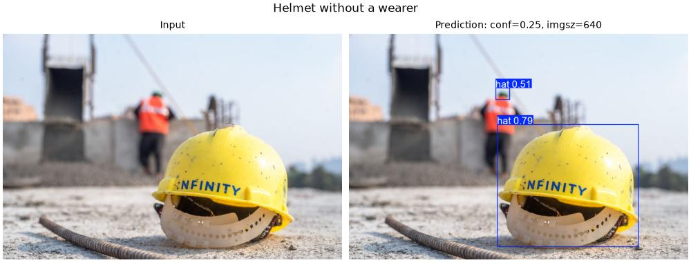

# Helmet-Wearing Head Detection · YOLOv8 + Gradio

A computer vision practice project using **Ultralytics YOLOv8n and SHWD**, covering data processing, training, evaluation, data quality auditing and a local interactive demo. The task detects helmet-wearing and unhelmeted **heads**.

**Python · PyTorch · Ultralytics · OpenCV · Gradio**

[中文](README.md) · [Quick start](#quick-start) · [Results](#results-and-scope) · [Technical retrospective (Chinese)](docs/PROJECT_STORY.md) · [Model release](https://github.com/CJ2323232/yolov8-learning/releases/tag/v1.0.0)



*Upload an image, adjust confidence, inspect counts and download the result. The screenshot shows the standard-inference interface; its training-set membership is unverified, so it is not independent test evidence.*

> **Status:** Existing weights run without retraining. Duplicate leakage was found in the historical split; auditing, workflow fixes and a screened-test reassessment are complete. Evaluation limits are stated below. Both 50-epoch runs and checkpoint hashes are verified. On the same 511-image validation split, best-epoch mAP50–95 is 60.244% (standard) versus 61.301% (P2), a 1.057-point difference in this run. Standard used MPS→CUDA resume; this is not a strict single-variable or multi-seed result. [Logs, curves and limitations](reports/p2_training_comparison/README.md). [Latest protocol and evidence](reports/p2_progress.md).

## Implemented work

| Area | Implementation | Evidence |
| --- | --- | --- |
| Data processing | VOC-to-YOLO conversion; class/dimension/box validation; difficult/truncated metadata | [Converter](voc_to_yolo.py) · [Protocol](docs/WORKFLOW.md) |
| Training and inference | Historical 50-epoch experiment, best checkpoint and single-image predictions | [Training records](reports/training/) · [Model card](models/README.md) |
| Data quality | Content deduplication, conflicting annotation quarantine, image/label hashes, group-aware splitting | [Audit](reports/clean_dataset_audit.json) · [Splitter](split_dataset.py) |
| Traceability | Model/data identities, effective parameters, environment records and evaluation checks | [Workflow](workflow.py) · [Fix validation](reports/fix_validation.json) |
| Evaluation | 416/640/960 input-size experiment; unchanged-model reassessment with per-class metrics | [Size experiment](reports/size_comparison.md) · [Reassessment](reports/legacy_test_reassessment.md) |
| Application and analysis | Gradio UI and qualitative analysis of false positives and challenging scenes | [App](app.py) · [Cases](reports/failure_cases.md) |
| Sliced inference evaluation | SAHI integration, 640/960/1280 comparison, single-tile fix and 529-image recheck with negative results retained | [Evaluation](reports/sahi_evaluation.md) · [Code](helmet_inference.py) |

Additional work: conservative scene-risk isolation (6,488/511/508 images), official standard/P2 variants with matched shared-layer initialization, ordinary inference at 640/960, and checkpoint-preserving Mac-to-Windows migration. [Data evidence](reports/scene_isolation/README.md) · [P2](docs/P2.md) · [Migration](docs/WINDOWS_MIGRATION.md).

The work focuses on data handling, experiments and integration. The detector architecture and training framework are provided by Ultralytics; no new detector architecture is proposed.

## Quick start

**No training or full dataset download is required.** Download the repository ZIP, or use these macOS / Linux commands:

```bash
git clone https://github.com/CJ2323232/yolov8-learning.git
cd yolov8-learning
python3 -m venv .venv
source .venv/bin/activate
python -m pip install -r requirements-gradio.txt
python download_weights.py
python app.py
```

On Windows CMD, create the environment with `python -m venv .venv` and activate it with `.venv\Scripts\activate.bat`; use the same subsequent commands. Open the printed local URL, usually `http://127.0.0.1:7860`, upload an image and click **Submit**. Keep the terminal running; stop with `Control+C`.

The app selects MPS / CUDA / CPU automatically. Weights are stored at `models/helmet_yolov8n.pt` and verified with SHA256. Registered new training artifacts take precedence; otherwise the app explicitly labels the historical demo model. It serves single-image inference locally without public hosting.

The UI offers standard or SAHI inference with shared weights; standard inference remains the default. SAHI uses 640×640 tiles, 20% overlap and class-aware merging with an additional full-image pass for multiple tiles. Single-tile inputs now use the standard path directly. Completed experiments show a recall gain with more unmatched predictions and lower overall F1 than standard inference. [Integration notes](docs/SAHI.md) · [Full evaluation](reports/sahi_evaluation.md).

Verified local environment: Python **3.14.7**, PyTorch **2.14.0**, Ultralytics **8.4.164**, Gradio **6.30.0**. Historical training used Mac MPS; reassessment used CPU. The Mac environment snapshot does not guarantee full dependency compatibility on Windows.

## Results and scope

### Screened-test reassessment with unchanged weights

The same best checkpoint from the historical 50-epoch experiment was evaluated without training or fine-tuning. Screening retained **474 images with 4,816 ground-truth boxes** from the **original 759-image test set**. The other 285 images include confirmed duplicates, within-test redundancy and possible related images; they are not all confirmed leakage.

| Evaluation set | Images | Precision | Recall | mAP50 | mAP50–95 |
| --- | ---: | ---: | ---: | ---: | ---: |
| Screened original-test subset | 474 | 0.9079 | 0.8544 | 0.9173 | 0.6063 |

**Scope:** This is post-hoc subset sensitivity analysis, not proof of complete scene independence or improved model performance. Evaluation used CPU, imgsz=640 and batch=4. P/R are class means at the maximum mean-F1 confidence point, not results at the UI threshold of 0.25.

[Method and limitations](reports/legacy_test_reassessment.md) · [Per-image decisions](reports/legacy_test_review/screening_decisions.csv) · [Raw metrics](reports/legacy_test_review/screened_test_metrics.json)

A [fixed-confidence error diagnosis](reports/small_object_analysis.md) now stratifies ordinary-inference misses by ground-truth size and provides manual-review steps. It is not a new independent test or evidence of SAHI improvement.

### SAHI slicing and single-tile fix

Same historical checkpoint and confidence 0.25 on a frozen **529-image screened original-validation subset**. Legacy 640/960/1280 tiles were compared; the extra merge on single-tile inputs was diagnosed and bypassed. The fixed 640 mode was rerun on all 529 images.

| Configuration | Overall recall | Tiny recall | Unmatched predictions | Micro F1 |
| --- | --- | --- | --- | --- |
| Standard | 93.13% | 81.22% | 747 | 90.33% |
| Legacy SAHI 640 | 92.63% | 83.11% | 975 | 88.34% |
| Fixed SAHI 640 | 93.47% | 83.84% | 1055 | 88.20% |

The fix recovers 48 matches versus legacy SAHI but adds 80 unmatched predictions. Relative to standard inference, it gains 19 net matches and adds 308 unmatched predictions. **Standard remains the default; SAHI is not presented as an overall performance improvement.** Tiny recall includes both head classes. Unmatched predictions can include duplicates, localization differences and annotation issues. This is exploratory validation, not an independent test.

[Complete evaluation and limitations](reports/sahi_evaluation.md) · [Numeric evidence and reproduction](reports/sahi_evaluation/)

### Input size versus inference time

Same checkpoint and 758 historical validation images; only input size changes:

| Input size | mAP50–95 | CPU model inference ms/image |
| ---: | ---: | ---: |
| 416 | 0.5484 | 7.64 |
| 640 | 0.6145 | 15.31 |
| 960 | 0.6307 | 33.77 |



In this run, 960 produced **1.62 percentage points** higher mAP50–95 than 640 with about **2.2×** the model inference time. These are exploratory measurements on the historical split with duplicate leakage. Each size was measured once; timing excludes preprocessing, postprocessing and UI work. They are not independent generalization or stable hardware benchmarks; small-object AP was not separately measured.

[Conditions and original records](reports/size_comparison.md) · [Historical experiments](reports/README.md)

## A concrete failure



A helmet on the ground was predicted as `hat` at confidence around **0.79**, despite having no wearer. This illustrates the difference between helmet appearance and the task of helmet-wearing heads. Negative examples and explicit head/helmet relations are hypotheses to test, not implemented accuracy improvements.

[Cases, sources and settings](reports/failure_cases.md) · [15 external-image examples](reports/external_gallery.md). The external images have no ground-truth boxes; no external mAP or miss rate is claimed.

## Data and reproducibility

Source: [SHWD](https://github.com/njvisionpower/Safety-Helmet-Wearing-Dataset). Original dataset images are not bundled. `0: hat` means a helmet-wearing head; `1: person` means an unhelmeted head, not a full-body person.

Flow: **VOC images/XML → conversion and validation → deduplication, quarantine and split → training and artifact registration → evaluation/inference → Gradio**.

Auditing quarantined **74 conflicting image variants across 37 groups** and generated a **6,005 / 750 / 752** train/validation/test split. A subsequent conservative risk-group assignment retained all 7,507 accepted images and moved 491, yielding **6,488 / 511 / 508**. Retrieved candidate edges no longer cross splits. All 1,999 PartA classroom images are in training; this is not exhaustive scene-independence proof or an unseen-classroom benchmark. The historical checkpoint cannot serve as an independent baseline on this reshuffled split.

Historical experiments, corrected code and small-scale workflow checks are recorded separately. **Final standard/P2 artifacts have been verified and training-validation results published.** Fixed-confidence size-stratified recall and latency remain to be measured. Follow the [training workflow](docs/WORKFLOW.md) and [comparison protocol](reports/p2_progress.md). Historical 1/5/50-epoch records are not three independent from-scratch controlled experiments.

| Entry points | Purpose |
| --- | --- |
| [voc_to_yolo.py](voc_to_yolo.py), [split_dataset.py](split_dataset.py) | Conversion, validation, deduplication and splitting |
| [workflow.py](workflow.py), [run.py](run.py) | Integrity checks, artifact management and execution |
| [train_helmet.py](train_helmet.py), [test_helmet.py](test_helmet.py) | Training and evaluation |
| [review_legacy_test.py](review_legacy_test.py) | Original-test screening and unchanged-model reassessment |
| [benchmark_sizes.py](benchmark_sizes.py) | Input-size experiments |
| [app.py](app.py), [predict_external.py](predict_external.py) | Local UI and external-image predictions |

[Fix log](docs/FIXES_2026-10-13.md) · [Model card](models/README.md) · [FAQ](docs/FAQ.md)

## Next steps

- Analyze false positives and misses using existing annotations, including size and occlusion effects.
- Repeat model and end-to-end timing; choose operating confidence on validation data.
- Use the verified best checkpoints for fixed-confidence, size-stratified validation and latency measurements; freeze settings before test evaluation.

Video detection, batch uploads and public hosting are not implemented. Suitability for real safety-management decisions has not been established.

## Credits and terms

Models and APIs: [Ultralytics](https://github.com/ultralytics/ultralytics), subject to its [AGPL-3.0 / Enterprise terms](https://www.ultralytics.com/license). UI: [Gradio](https://github.com/gradio-app/gradio).

Dataset: [SHWD](https://github.com/njvisionpower/Safety-Helmet-Wearing-Dataset). Its repository is MIT-licensed, but images include web and SCUT-HEAD sources; original data is not redistributed here. External examples have per-image credits and follow the [Pexels License](https://www.pexels.com/license/). Predictions are not claims about the subjects' actual safety status or endorsement.
