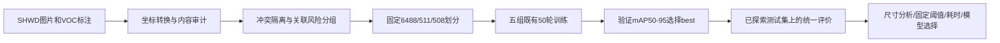
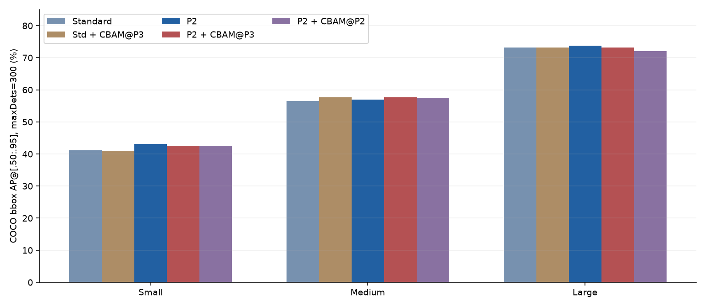
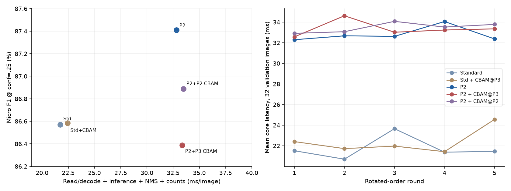

# YOLOv8 安全帽头部检测：五组统一实验报告

整理日期：2026-10-29。实验与后续评价截至2026-10-28已完成；本次只核对既有配置、CSV、权重哈希和评价记录，**没有重新训练、推理或计算新模型指标**。

**当前推荐为 P2 单模型、conf=0.25。** 该选择综合既有验证结果、小目标AP、固定阈值错误代价和CPU开销，是已探索数据上的事后工程选择，不是全新盲测证明。P2+P3-CBAM的原GPU总体AP略高，但并非当前工作点最优。五组和负结果全部保留。

## 1. 任务、来源与执行流程

目标是定位头部并区分两类：`0=hat` 为戴安全帽的头部，`1=person` 为未戴安全帽的头部。**person不是全身行人类别**；本项目不是普通COCO行人检测，也不由安全帽框直接推断真实安全合规状态。

基础网络和P2结构来自 Ultralytics YOLOv8；CBAM机制来自[原论文](https://openaccess.thecvf.com/content_ECCV_2018/html/Sanghyun_Woo_Convolutional_Block_Attention_ECCV_2018_paper.html)，项目实现与接入方式见[来源记录](../models/configs/p2_cbam_sources.json)。数据来自[SHWD](https://github.com/njvisionpower/Safety-Helmet-Wearing-Dataset)。项目贡献是数据治理、结构接入、实验核验和系统取舍，不把这些上游方法当作原创算法。



程序代码采用根[AGPL-3.0](../LICENSE)，独立第三方代码保留原许可。涉及SCUT-HEAD的研究材料沿用上游学术研究用途范围；根代码许可不扩大照片、数据或权重权利。权重再分发和商业用途并未获得完整确认。见[维护者采用的使用与分发规则](license_audit.md#本项目采用的使用与分发规则2026-10-29)。

## 2. 五组结构与实际CBAM位置

| 组ID | 模型 | Detect输入尺度 | CBAM接入 | 参数量（未融合结构） |
|---|---|---|---|---:|
| 01 | 标准YOLOv8n | P3/P4/P5 | 无 | 3,011,238 |
| 02 | 标准+P3-CBAM | P3/P4/P5 | 特征15 → CBAM22 → Detect23；P3，64通道 | 3,011,916 |
| 03 | YOLOv8n-P2 | P2/P3/P4/P5 | 无 | 2,926,824 |
| 04 | P2+P3-CBAM | P2/P3/P4/P5 | 特征21 → CBAM28 → Detect29；P3，64通道 | 2,927,502 |
| 05 | P2+P2-CBAM | P2/P3/P4/P5 | 特征18 → CBAM28 → Detect29；P2，32通道 | 2,927,084 |

P2/P3/P4/P5的步长分别为4/8/16/32。两组新增P3注意力均为678参数；旧P2注意力为260参数。三组复用 `helmet_cbam.P2CBAM` 类名以兼容既有权重，类名不代表总是作用于P2。模块用共享MLP处理通道avg/max池化，再施加空间注意力；空间卷积没有BN，与原作者参考实现有明确差异。

结构来源：[标准/P2配置](../models/configs/)；[标准P3配置](../tools/p3_cbam_standard/helmet_yolov8n_standard_p3_cbam.yaml)；[P2的P3配置](../tools/p3_cbam_p2/helmet_yolov8n_p2_p3_cbam.yaml)；[模块实现](../helmet_cbam.py)。参数量和前向形状来自已有[检查点结构记录](../reports/final_evaluation/protocol.json)，不是用通用YOLO宣传参数表代填。

01/02/03/04构成“有无P2 × 有无P3-CBAM”的四组合布局，注意力尺度、通道和初始注意力参数对齐；05是额外的位置/规模探索。**组合完整不代表全部历史变量严格一致**，初始化局限见第5节。05与04同时改变尺度、通道和参数量，不是纯接入位置消融。

## 3. 固定数据与泄漏风险治理

原始版本有7581张图；37组74张标注冲突版本被隔离，接受7507张。后续关联风险隔离保留这7507张，491张变更分区，图片与标签字节保持不变。

| 分区 | 图片 | hat框 | person框 |
|---|---:|---:|---:|
| train | 6488 | 7248 | 102502 |
| val | 511 | 762 | 4623 |
| test | 508 | 946 | 3929 |

清单SHA256：`5781ecdffa173010f539189b15565220f5e2ac597b5f8ea72f5cf7b1e8bf63e4`。本次核对五组 `input_identity.json` 的数据对象逐字段一致，而不只比较数据文件路径。原记录路径不同，不代表实际划分不同。

| 治理指标 | 关联隔离前 | 隔离后 |
|---|---:|---:|
| 已检索候选跨分区关系 | 20,466对 | 0对 |
| 人工确认同组的跨分区关系 | 10对 | 0对 |
| PartA训练/验证/测试图 | 1593/206/200 | 1999/0/0 |

这些对由2126张不同图片构成，一图可参与多对。候选关系不是20466张图片，也不等于20466次确认泄漏。隔离是保守检索约束，不证明未知同源关系已穷尽；PartA全部训练，不能声称未见教室泛化。`difficult` 沿用 `include_as_ordinary`，未在本次整理中改成忽略目标。

这些是数据质量与评价条件的改善，**不能换算成某个mAP提升**。旧/新标准版还同时改变数据与训练流程，不能用两次分数差归因于去泄漏。来源：[治理前后证据](../reports/scene_isolation/README.md)、[审计记录](../reports/scene_isolation/dataset_audit.json)、[标准版演进](../reports/baseline_evolution.md)。

## 4. 真实训练设置

本表从五份 `effective_args.json` 比较取得；记录一致的训练配置不被本次整理改动。

| 类别 | 五组共同设置 |
|---|---|
| 训练预算 | epochs=50，imgsz=640，batch=2，fraction=1，workers=0 |
| 优化器 | AdamW，lr0=0.001667，lrf=0.01，momentum=0.9，weight_decay=0.0005，nbs=64 |
| 调度 | cos_lr=False；warmup_epochs=3，warmup_momentum=0.8，warmup_bias_lr=0 |
| 随机与精度 | seed=0，deterministic=True，amp=True；deterministic不等于跨设备逐位一致 |
| 初始化/形状 | pretrained=True，cls_remap=False，freeze=None，multi_scale=0，训练rect=False |
| 检测损失 | box=7.5，cls=0.5，dfl=1.5 |
| 颜色增强 | hsv_h=0.015，hsv_s=0.7，hsv_v=0.4 |
| 几何增强 | degrees=0，translate=0.1，scale=0.5，shear=0，perspective=0，flipud=0，fliplr=0.5 |
| 混合增强 | mosaic=1，close_mosaic=10，mixup=0，cutmix=0，copy_paste=0 |

`batch=2`是微批量；`nbs=64`是框架名义批量参数，不表示每一步实际同时放入64张图。配置还包含分类任务的 `auto_augment`、`erasing` 默认值，不能把它们都写成检测实际采用的增强。

全部保存参数的差异集中在 `data/model/name/project/save_dir/resume`：结构、目录与历史恢复元数据。结构变化是实验因素；数据身份已独立核验相同。恢复字段如实保留，不通过改写旧JSON伪装一致。[各组原训练记录副本](../reports/final_evaluation/training/)；[本次逐项核验摘要](../reports/experiment_report_verification.json)。

## 5. 初始化与环境差异

共同官方初始化权重SHA256：`f59b3d833e2ff32e194b5bb8e08d211dc7c5bdf144b90d2c8412c47ccfc83b36`。标准/P2都只迁移共同层0–15，共210个状态张量；分歧/新增部分保持其新建初始化，不从已训练best.pt继续微调，也不把COCO person语义映射成未戴帽头部。

CBAM各组从对应标准或P2父结构的**初始状态**映射非CBAM张量，再单独初始化注意力。两组新P3注意力初始状态哈希一致。需要区分“与当次重建父模型一致”和“与历史训练父模型一致”：

| 对照 | 已核实边界 |
|---|---|
| 标准 vs 标准+P3-CBAM | 共有预训练部分一致；历史非预训练剩余状态不完全一致。不能用与当次重建父模型匹配的布尔值覆盖这项差异 |
| P2 vs P2+P3-CBAM | 历史共有与剩余初始状态核验一致；非CBAM映射一致 |
| P2 vs 旧P2+P2-CBAM | 非CBAM状态按P2父初始化映射，旧接入组保留为独立探索 |

初始状态差异记录伴随不同平台/torch构建，但现有证据不能确定唯一原因。不能宣称标准配对已排除所有混杂，也不凭单次训练宣称显著交互收益。

已保存的Windows记录均报告Python3.10.10、torch2.14.0+cu126、Ultralytics8.4.164；标准和三个CBAM记录能确认RTX3060 Laptop/CUDA12.6，早期P2记录缺GPU型号及CUDA运行时字段。三个CBAM组另有完整包列表，确认torchvision0.29.0+cu126、NumPy2.2.6；标准缺NumPy记录，早期P2缺NumPy与torchvision记录。**不能用三个完整列表冒充五组环境均逐项核验完毕。** 历史标准版包含MPS→CUDA迁移，原恢复记录保留；这里仅披露，不追加训练。

应用/后续CPU评价环境是Mac arm64、Python3.14.7、torch2.14.0、NumPy2.5.3，与历史训练环境不同。安装分开说明见[环境文档](ENVIRONMENTS.md)。具体初始化证据见[01](../reports/final_evaluation/training/01_standard/initialization.json)、[02](../reports/final_evaluation/training/02_standard_P3_CBAM/initialization.json)、[03](../reports/final_evaluation/training/03_P2/initialization.json)、[04](../reports/final_evaluation/training/04_P2_P3_CBAM/initialization.json)、[05](../reports/final_evaluation/training/05_P2_P2_CBAM/initialization.json)。

## 6. best.pt如何选择及验证结果

每份CSV均有50轮，表中轮次是该组**唯一最高验证mAP50–95**所在行。已安装Ultralytics8.4.164的检测fitness权重为 `[0,0,0,1]`，trainer按最佳fitness保存best，与日志选择一致。未用测试分数重选checkpoint。

| 模型 | best轮次 | 验证P | 验证R | 验证mAP50 | 验证mAP50–95 |
|---|---|---|---|---|---|
| 标准版 | 40 | 89.160% | 86.152% | 91.584% | 60.244% |
| 标准版+P3-CBAM | 46 | 89.472% | 86.051% | 91.834% | 60.450% |
| 原始P2 | 48 | 90.248% | 86.829% | 92.995% | 61.301% |
| P2+P3-CBAM | 39 | 88.325% | 85.887% | 92.559% | 60.962% |
| P2+P2-CBAM | 44 | 90.020% | 85.150% | 91.783% | 60.800% |

单位均为百分比。验证P/R是库报告的相应工作点结果，**不是conf=.25的固定工作点**。可在[训练CSV目录](../reports/final_evaluation/training/)逐组查看；CSV行号（含表头）依次为41/47/49/40/45。[核验摘要](../reports/experiment_report_verification.json)保留未四舍五入数值、行号、来源哈希及best选择检查。

## 7. 评价协议必须分开

| 口径 | 输入与设备 | 定义 |
|---|---|---|
| 原GPU总体测试 | 同一508张/4875框；Ultralytics8.4.164、RTX3060、FP16、batch4、640、rect=True、候选conf=.001、NMS IoU=.7、max_det300 | 原记录的mAP50/mAP50–95；库P/R取各自最大平均F1附近，不是固定conf=.25 |
| 后续CPU面积AP | 相同checkpoint和测试图；CPU FP32、batch1、640、候选conf=.001、NMS IoU=.7、max_det300 | pycocotools2.0.11 COCO式bbox AP@300，IoU=.50:.05:.95、101点插值；不是默认COCO AP@100 |
| 固定工作点 | 同批CPU预测，conf=.25 | score降序、同类一对一IoU≥.5，微平均TP/FP/FN/P/R/F1；不是mAP |
| CPU耗时 | 32张验证图、5轮轮换，每模型160次；FP32、batch1、torch8线程、interop1、OpenCV1，预热5次 | 模型驻留后的核心流程，以及另加绘图/内存PNG编码的流程；不含加载/UI/网络/落盘 |

面积AP与原GPU总体AP的实现、精度和批尺寸不同；不能跨口径直接相减或挑较高数值宣称提升。候选conf=.001达到300框上限的图数依次为9/7/17/24/23，存在候选截断限制；conf=.25时没有图达到300上限。来源：[冻结协议](../reports/final_evaluation/protocol.json)、[候选核验](../reports/final_evaluation/prediction_verification.json)。

## 8. 总体测试结果：原GPU表与CPU复核分列

| 模型 | 原GPU mAP50 | 原GPU mAP50–95 | CPU COCO式总体AP@300 |
|---|---|---|---|
| 标准版 | 86.742% | 57.575% | 57.149% |
| 标准版+P3-CBAM | 87.064% | 57.562% | 57.494% |
| 原始P2 | 86.780% | 58.183% | 58.092% |
| P2+P3-CBAM | 87.689% | 58.410% | 57.986% |
| P2+P2-CBAM | 87.019% | 57.532% | 57.513% |

单位为百分比。与用户给出的五行GPU测试表按三位小数逐行交叉核对，**差异为0**；另外与本地原始测试 `metrics.json` 逐字段核对一致。来源：[原GPU记录](../reports/final_evaluation/original_gpu_test_metrics.json)、[CPU汇总](../reports/final_evaluation/summary.csv)。原记录中的 `mode=val` 默认训练参数不是再次训练的参数；不能把评估对象内的 `epochs=100`、`optimizer=auto` 当作这五组实际训练设置。

两套口径中P2/P2+P3-CBAM排序不同，表中如实保留；这不能归因于某一个单独原因，也不靠混表决定模型。

## 9. 尺寸分组AP与召回（已完成）

分层按**原图GT框面积**，不按整图尺寸。固定Recall的互斥分母为small2072、medium1908、large895，总4875；范围为 `<32²`、`[32²,96²)`、`≥96²`。COCO AP沿用官方含端点和ignore规则；本数据在32²/96²边界均无GT，因此这里的分母一致。匹配先覆盖全部GT，再按GT面积分组，不提前过滤GT制造误匹配。未匹配预测没有真实GT面积，故不编造按真实尺寸分组的Precision/FP。

| 模型 | APsmall | APmedium | APlarge | Rsmall@.25 | Rmedium@.25 | Rlarge@.25 |
|---|---|---|---|---|---|---|
| 标准版 | 41.178% | 56.580% | 73.182% | 82.191% | 88.994% | 95.419% |
| 标准版+P3-CBAM | 40.970% | 57.693% | 73.151% | 82.191% | 89.465% | 95.642% |
| 原始P2 | 43.119% | 56.971% | 73.726% | 82.819% | 89.151% | 95.307% |
| P2+P3-CBAM | 42.583% | 57.711% | 73.163% | 83.591% | 89.413% | 95.196% |
| P2+P2-CBAM | 42.544% | 57.456% | 72.021% | 82.529% | 89.203% | 94.525% |

以上是全部两类的百分比。小安全帽单独看（220个GT）：

| 模型 | 小安全帽AP50–95 | 小安全帽R@.25 | 匹配/GT |
|---|---|---|---|
| 标准版 | 37.471% | 57.273% | 126/220 |
| 标准版+P3-CBAM | 37.130% | 57.727% | 127/220 |
| 原始P2 | 40.032% | 59.091% | 130/220 |
| P2+P3-CBAM | 38.783% | 57.273% | 126/220 |
| P2+P2-CBAM | 38.684% | 57.727% | 127/220 |

P2相对标准版，全部小目标AP增加1.941个百分点，小安全帽AP增加2.561个百分点；固定conf下小安全帽仅多匹配4个（126→130），不把它描述为解决了远距离检测。

短边按 `GT短边×640/原图最长边` 计算时，<8px有139个安全帽，五组分别只匹配1/1/0/4/1；<16px累计217个，分别匹配31/31/35/38/33。累计组与细分组重叠，不能再相加。它是输入尺度下微小头部代理，**没有实际拍摄距离标签**。



来源：[面积指标](../reports/final_evaluation/area_metrics.csv)、[尺寸分母](../reports/final_evaluation/size_support.json)、[微小安全帽](../reports/final_evaluation/tiny_helmet_recall.csv)。本次复用既有真实图表，没有重跑尺寸评价。

## 10. conf=.25时的误检代价与漏检

| 模型 | TP | FP未匹配 | FN | Precision | Recall | F1 |
|---|---|---|---|---|---|---|
| 标准版 | 4255 | 700 | 620 | 85.873% | 87.282% | 86.572% |
| 标准版+P3-CBAM | 4266 | 713 | 609 | 85.680% | 87.508% | 86.584% |
| 原始P2 | 4270 | 625 | 605 | 87.232% | 87.590% | 87.410% |
| P2+P3-CBAM | 4290 | 767 | 585 | 84.833% | 88.000% | 86.387% |
| P2+P2-CBAM | 4258 | 668 | 617 | 86.439% | 87.344% | 86.889% |

P/R/F1单位为百分比。FP是相对现有标注的未匹配预测，可能含漏标，未全部经人工确认，不能将每个FP都称为真实误检。P2+P3-CBAM比P2多匹配20个、少漏20个，同时增加142个未匹配预测，F1下降1.023个百分点；hat类仅多匹配2个，未匹配预测增加45个。

2000次配对风险组bootstrap的P2+P3-CBAM−P2 F1差值95%区间为[-1.635,-0.404]个百分点；这是固定模型、当前样本的不确定性。此测试集508图对应508个已检索组，不能证明所有真实场景独立，也不能当成多种子训练显著性结论。[固定点逐类结果](../reports/final_evaluation/class_fixed_metrics.csv)、[配对不确定性](../reports/final_evaluation/paired_uncertainty.json)。

## 11. 推理效率与计算量证据

| 模型 | 核心均值ms/图 | 含绘图编码均值ms/图 | 有效测量次数 |
|---|---|---|---|
| 标准版 | 21.745 | 58.495 | 160 |
| 标准版+P3-CBAM | 22.420 | 60.354 | 160 |
| 原始P2 | 32.804 | 69.488 | 160 |
| P2+P3-CBAM | 33.359 | 69.954 | 160 |
| P2+P2-CBAM | 33.473 | 70.571 | 160 |

core包括读图/解码、RGB转换、预处理、网络、NMS、框取回与计数；rendered另含画框与内存PNG编码（compression3）。不含模型加载、浏览器/Gradio/网络、文件输出；文件缓存较热。不能当作完整网页响应延迟、CUDA延迟或直接倒数称通用FPS。

本次从[800行原始计时](../reports/final_evaluation/benchmark_raw.csv)重新汇总，五组各160次/32图，均值与[原摘要](../reports/final_evaluation/benchmark_summary.json)一致。P2核心耗时约为标准版的1.51倍；P2与P2+P3-CBAM耗时接近，不宣称微小差值证明稳定速度优势。抖动不等于多次训练稳定性。

计算量仅找到两组同类未融合框架日志估算：标准+P3-CBAM为8.2 GFLOPs，P2+P3-CBAM为12.4 GFLOPs；其余三组暂无本次已核实的同口径日志，留空，不按网络常识补齐。它们不是设备实测吞吐率，不混用融合后的8.1/12.2值。原日志位置与提取原文保存在[核验JSON](../reports/experiment_report_verification.json)的 `partial_flops_log_evidence`；日志本体保留本地 `run/`，公开仓库不含全部大日志。



## 12. 解释与最终选择

- **P2的价值有具体边界**：本批小目标AP、小安全帽AP和固定工作点F1优于标准版；代价是CPU处理更慢。极小安全帽仍几乎检不出，不声称全面改善。
- **CBAM结果保留负收益**：标准+P3-CBAM相对标准的原GPU mAP50–95差约−0.012个百分点；P2+P3-CBAM相对P2约+0.2276个百分点；旧P2+P2-CBAM相对P2约−0.650个百分点。单次微小变化不称显著突破。
- **当前保留P2单模型/conf=.25**：它的验证mAP50–95最高、当前共同工作点F1最高，并有小目标AP证据。P2+P3-CBAM的原GPU总体AP最高，但该工作点未匹配预测代价更大。标准版CPU更快，可保留作资源受限备选。
- **不因加入模块就必须部署模块**：结构实验、失败分析和工程选型本身是项目成果；不删掉不理想的一组来制造“改进成功”。

选择基于既有测试探索，不是独立外部泛化证明。阈值.25是共同诊断点，不代表每组分别在验证集校准后的最优阈值。后续可仅在验证集校准阈值，再用新的未参与选择场景确认。

## 13. 复现入口与可复现边界

先查看[环境](ENVIRONMENTS.md)和[数据准备/固定划分恢复](../reports/scene_isolation/README.md)，按原许可从原始来源取得对应图片和标注。训练/推理需有权使用的可信checkpoint；[五组清单](../models/release_manifest.json)给出来源相对路径、大小和SHA256，**没有五组原始 PT 的公开下载URL**。另有独立导出并清理元信息的 P2 ONNX 用于[浏览器演示](DEPLOYMENT.md)，未新增整套 ONNX AP 评测，不改变五组复现边界。[模型卡](../models/MODEL_CARD.md)说明当前权重和许可状态；历史v1.0.0不能重现这五组成绩。

在项目根目录准备好原数据后，仅做路径审核和训练前检查的示例：

```bash
python cli.py check-data --data data.example.yaml --data-root datasets/helmet_scene_isolated_v1 --write-config outputs/data_resolved.yaml
python train_helmet.py --variant standard --data outputs/data_resolved.yaml --dry-run
python train_helmet.py --variant p2 --data outputs/data_resolved.yaml --dry-run
```

`outputs/data_resolved.yaml`必须是新的文件名；已有文件拒绝覆盖。CBAM三个原入口分别为 `train_p2_cbam.py`、`tools/p3_cbam_standard/train.py`、`tools/p3_cbam_p2/train.py`，使用各自 `--check`，并需要其原数据、初始化和环境前置条件；P3两组默认仅检查、正式训练须显式 `--train`。不额外实现一套训练代码。

已有权重的验证预检查示例：

```bash
python cli.py val --weights run/helmet_p2_isolated_640_windows/weights/best.pt --data data.example.yaml --data-root datasets/helmet_scene_isolated_v1 --split val --device cpu --output outputs/p2_val_review --dry-run
```

此命令不产生验证成绩。移除dry-run才会实际评估；完整历史尺寸/计时协议见[最终评价说明](../reports/final_evaluation/README.md)，冻结脚本仍包含作者本机历史路径，不承诺陌生环境下一键运行。仅有公开代码和旧权重不足以完整复现全部五组。原实验记录中的个人绝对路径属于历史元数据，不应照抄成新用户配置。

## 14. 必须保留的限制

1. 五组均为seed0单次训练；50轮不是50次独立重复，不能宣称统计显著或稳定提升。
2. 标准配对历史非预训练初始化不完全一致；部分环境记录不完整，标准组还有跨设备训练历史。四组合设计完整，但不能宣称全部历史变量已严格控制。
3. 测试集此前已经用于探索，后续尺寸/固定点分析前总体分数已经已知；冻结的是后续分析协议，不是原始研究开始前的盲测预注册。
4. 风险检索并非穷尽；PartA训练隔离不证明未见教室泛化；15张外部照片无完整GT，不能提供外部AP。
5. FP未全经人工复核，标注可能漏标；IoU阈值、定位偏差、类别混淆和置信度都会影响固定点计数。
6. 尺寸AP**已完成**，但面积分组和缩放短边均不等于真实距离；极小目标仍是明显短板。
7. CPU与GPU、COCO与Ultralytics评价口径不能混算；计时没有覆盖完整网页交互或Windows CUDA部署全过程。
8. 无完整多种子、接入位置规模控制、阈值校准或新的外部盲测；bootstrap不是这些实验的替代品。
9. 新权重分发、上游数据与图片授权链尚未完整核实；采用研究用途策略不会自动补齐缺失权利。

## 15. 后续方向与本次核验

本报告整理时（2026-10-29）的工程待办为 Gradio 模型选择、参数展示、逐框表格与异常处理。后续这些应用改进已完成，并另行上线了 P2 浏览器精简演示；当前使用范围见[Gradio 说明](GRADIO_DEMO.md)与[部署说明](DEPLOYMENT.md)，不作为新增模型精度证据。新环境检查以实际验收记录为准，不等于 Windows/CUDA、重新训练或 AP 复现。算法方面如需更强结论，优先新场景数据/标注核查、验证集阈值校准及多种子控制，不继续无限添加注意力模块；这些算法方向尚未执行。

本次完成：五份50轮CSV与公开副本匹配、唯一最佳验证行核对、五份checkpoint哈希匹配、五份原GPU测试JSON与公开原记录匹配、用户五行表无差异、共同参数与数据身份核对、CPU固定点统计核对及800行计时重汇总。详情见[机器可读核验记录](../reports/experiment_report_verification.json)。没有修改原数据、模型配置、训练代码、原始记录或权重。
