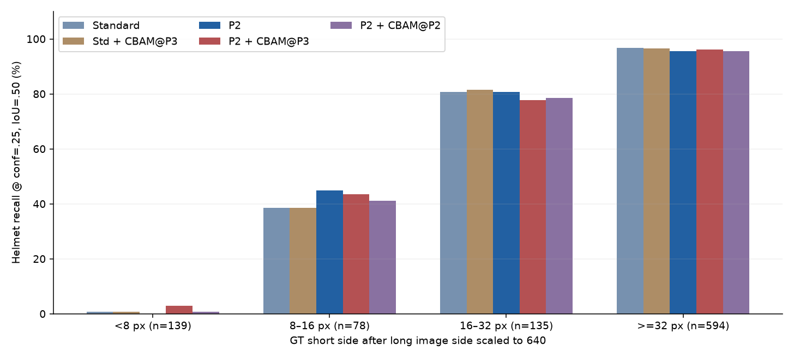

# 五组结构实验收尾：尺寸、固定工作点与完整本地推理耗时

2026-10-28。五组既有best.pt，无训练、无测试阈值搜索、无检查点重选。

**结论：保留P2、conf=0.25作为当前单模型推荐。** P2在本批小目标AP与固定工作点F1上优于标准版。P2＋P3 CBAM有局部召回收益和原GPU测试AP的小幅收益，但固定工作点新增未匹配预测较多，尚不值得替换P2。CPU速度接近，不把微小耗时差或抖动解释为更稳定的网络。

## 1. 完整保留五组训练与原测试结果

|模型|最佳轮次|参数量|验证mAP50–95|原GPU测试mAP50–95|
|---|---|---|---|---|
|标准版|40|3011238|60.24%|57.57%|
|标准版+P3-CBAM|46|3011916|60.45%|57.56%|
|原始P2|48|2926824|61.30%|58.18%|
|P2+P3-CBAM|39|2927502|60.96%|58.41%|
|P2+P2-CBAM|44|2927084|60.80%|57.53%|

原GPU表使用Ultralytics8.4.164、RTX3060、FP16、batch4；最佳轮次先由验证集选定。以下新尺寸AP使用同一批模型的CPU FP32、batch1预测及COCOeval，指标实现和数值精度不同，不能拿两种口径的总AP直接计算提升。

## 2. 按原图面积统计AP与固定阈值召回

AP使用官方pycocotools2.0.11的COCO bbox评价：IoU=.50:.05:.95、101点插值、maxDets=300，候选conf=.001。小/中/大按**原图标注框面积**分层；与32×32、96×96比较，不按整张图片尺寸，也不是缩放后的框尺寸。沿用[COCOeval默认面积与忽略规则](https://github.com/cocodataset/cocoapi/blob/master/PythonAPI/pycocotools/cocoeval.py)，名称为COCO式bbox AP@300，而非默认AP@100。

|模型|APsmall|APmedium|APlarge|Rsmall@.25|Rmedium@.25|Rlarge@.25|
|---|---|---|---|---|---|---|
|标准版|41.18%|56.58%|73.18%|82.19%|88.99%|95.42%|
|标准版+P3-CBAM|40.97%|57.69%|73.15%|82.19%|89.47%|95.64%|
|原始P2|43.12%|56.97%|73.73%|82.82%|89.15%|95.31%|
|P2+P3-CBAM|42.58%|57.71%|73.16%|83.59%|89.41%|95.20%|
|P2+P2-CBAM|42.54%|57.46%|72.02%|82.53%|89.20%|94.53%|

固定Recall按所有GT先作同类一对一匹配，再按GT尺寸分组，互斥计数小2072、中1908、大895，总4875。此处用半开区间<32²、[32²,96²)、≥96²；COCO AP官方区间上下界包含端点。本数据端点计数见JSON核验，不把两种区间规则隐去。未匹配预测没有GT尺寸，因此不编造“按真实尺寸分组的FP或Precision”。COCO AP会按其官方忽略规则处理区间外GT和预测。

本批恰好落在32²/96²面积端点的标注均为0，因此两种区间计数在这里一致，见[尺寸分母核验](size_support.json)。候选conf=.001时达到300框上限的图数依模型为9/7/17/24/23，可能截断低分候选，完整保留[上限记录](prediction_verification.json)；conf=.25没有图达到上限，单图GT最多124个。

P2相对标准版，APsmall增加 **1.941个百分点**。这支持“本次小目标整体受益”，不意味着所有微小目标都受益。


### 安全帽类别单独看

|模型|小安全帽AP50–95|小安全帽Recall@.25|匹配/标注|
|---|---|---|---|
|标准版|37.47%|57.27%|126/220|
|标准版+P3-CBAM|37.13%|57.73%|127/220|
|原始P2|40.03%|59.09%|130/220|
|P2+P3-CBAM|38.78%|57.27%|126/220|
|P2+P2-CBAM|38.68%|57.73%|127/220|

P2的小安全帽AP提高 **2.561个百分点**；固定0.25下小安全帽匹配126→130，增加4个。这个改进量不大，不能说已经解决远距离安全帽问题。

### 输入尺度下的微小安全帽

定义：标注框短边 ×640/原图最长边；这是微小目标代理，没有真实拍摄距离标签。小于16px累计组与前两组重叠，不和其他组再次相加。

|模型|<8px /139|8–16px /78|16–32px /135|≥32px /594|<16px累计 /217|
|---|---|---|---|---|---|
|标准版|1 (0.72%)|30 (38.46%)|109 (80.74%)|575 (96.80%)|31 (14.29%)|
|标准版+P3-CBAM|1 (0.72%)|30 (38.46%)|110 (81.48%)|573 (96.46%)|31 (14.29%)|
|原始P2|0 (0.00%)|35 (44.87%)|109 (80.74%)|568 (95.62%)|35 (16.13%)|
|P2+P3-CBAM|4 (2.88%)|34 (43.59%)|105 (77.78%)|571 (96.13%)|38 (17.51%)|
|P2+P2-CBAM|1 (0.72%)|32 (41.03%)|106 (78.52%)|567 (95.45%)|33 (15.21%)|

小于8px的139个安全帽：标准版匹配1个、P2为0个，P2＋P3 CBAM为4个。极小目标仍是明显短板。不能只挑8–16px组的改善、忽略更小组的负结果。



## 3. 同一conf=0.25的误检、漏检与F1

五组均为640、rect=True、batch1、CPU FP32、NMS IoU=.7、max_det300。以score降序、同类别一对一IoU≥.5匹配；这里是微平均P/R/F1，**不是库在各自最佳F1处报告的P/R，也不是mAP**。FP指相对现有标签的未匹配预测，可能包含漏标，未经人工确认不一律称真实误检。

|模型|TP|FP未匹配预测|FN漏检|Precision|Recall|F1|
|---|---|---|---|---|---|---|
|标准版|4255|700|620|85.87%|87.28%|86.57%|
|标准版+P3-CBAM|4266|713|609|85.68%|87.51%|86.58%|
|原始P2|4270|625|605|87.23%|87.59%|87.41%|
|P2+P3-CBAM|4290|767|585|84.83%|88.00%|86.39%|
|P2+P2-CBAM|4258|668|617|86.44%|87.34%|86.89%|

|模型|戴帽TP|戴帽FP|戴帽FN|戴帽Precision|戴帽Recall|戴帽F1|
|---|---|---|---|---|---|---|
|标准版|715|97|231|88.05%|75.58%|81.34%|
|标准版+P3-CBAM|714|78|232|90.15%|75.48%|82.16%|
|原始P2|712|67|234|91.40%|75.26%|82.55%|
|P2+P3-CBAM|714|112|232|86.44%|75.48%|80.59%|
|P2+P2-CBAM|706|83|240|89.48%|74.63%|81.38%|

P2＋P3 CBAM相对P2：TP +20、FN −20、FP +142，F1 **-1.023个百分点**；安全帽仅多匹配2个，却增加45个未匹配安全帽预测。它可以多找回一些目标，但当前工作点的误检代价更大。

P2＋P3 CBAM−P2的F1差值，2000次配对风险组重采样95%区间为 **[-1.635, -0.404]个百分点**。本批508张测试图恰好对应508个检索组，数值上等价于按图重采样；未知同源关系可能仍存在。它只表示这批图、这些固定权重的样本不确定性，不是训练多随机种子显著性。

## 4. 完整本地图片处理耗时

环境：macOS-26.6-arm64-arm-64bit-Mach-O / arm64，torch2.14.0，CPU FP32，实际torch8线程、interop1、OpenCV1线程。32张按文件名均匀选取的验证图，每模型预热5次，5轮轮换模型顺序，共每模型160次、五模型800次。每轮图像顺序一致并固定随机种子。

|模型|核心均值ms|核心中位ms|核心P95ms|含绘图编码均值ms|含绘图编码P95ms|轮均值CV|
|---|---|---|---|---|---|---|
|标准版|21.74|19.92|31.18|58.49|122.17|4.61%|
|标准版+P3-CBAM|22.42|20.22|34.98|60.35|122.90|4.99%|
|原始P2|32.80|31.11|45.47|69.49|134.46|1.96%|
|P2+P3-CBAM|33.36|31.50|46.30|69.95|133.68|2.05%|
|P2+P2-CBAM|33.47|31.61|46.84|70.57|134.20|1.29%|

核心：读图/解码→RGB→预处理→网络→NMS→框取回与计数。含绘图编码：核心再加画框和内存PNG编码（压缩3）。均不含权重加载、网页/网络、文件输出；文件缓存已热。预热针对predict，绘图第一次使用的初始化仍可能进入第一轮。原图分辨率、目标数量和后台负载会影响分布；保留逐次时间和五轮均值。

P2与P2＋P3 CBAM核心均值为32.80/33.36ms，只差约1.7%。速度大致相当，不据此宣称P2显著更快或更稳定。两组含绘图编码的轮均值抖动也很小；这与训练稳定性是两回事。

这是Mac本地处理路径的计时，不是Windows CUDA实测，不是浏览器端到端响应，也不能直接换算成系统实时吞吐率。原GPU评估器的forward时间仅保留作历史参考。模型构造计时受导入及文件缓存先后影响，原始记录保留但不据此排冷启动速度名次。


## 5. 最终选择与负结果

- **当前推荐P2单模型，conf=0.25。** 它的验证mAP50–95最高，本轮固定工作点总体F1也最高；小目标和小安全帽AP优于标准版。
- 标准版更快，若设备预算更严格可作为轻量备选；不能省略P2约1.5倍核心CPU耗时的代价。
- P2＋P3 CBAM保留为结构实验：原GPU测试mAP50–95高0.228个百分点，但验证低0.339个百分点、固定阈值F1下降，微小安全帽仅补回少数。
- 标准版＋P3 CBAM与旧P2位置CBAM也完整保留；不删负结果，不把换接入位置后的实验合并成一个成功故事。
- 这是文档中的推荐；应用已使用原P2登记，本次没有自动替换权重、改阈值或改检测功能。

## 6. 实验限制

1. 五组均seed=0、单次训练。50个epoch不是50次独立重复；配对图像bootstrap也不能代替多种子。
2. 两个新P3 CBAM均64通道、678参数且初始注意力参数一致；标准版位于22接15，P2版位于28接21。P2配对历史非CBAM初始化核验一致，标准版配对则不完全一致，因此不宣称严格控制全部初始变量的二因素交互证据。
3. 旧P2分支CBAM为32通道、260参数，与P3位置组同时改变位置和规模，不能称纯位置单因素实验。
4. 测试集已被多次查看和使用；此前五组总分在本轮前已知。新协议在本轮分层、固定点与计时前冻结，不称最初全盲预注册。没有在测试上搜索阈值，但模型推荐仍属于事后综合判断。
5. 已检索跨分区关联隔离不等于排除所有未知场景关系。PartA教室来源全部训练用，现有测试不证明新教室泛化。
6. 15张外部图没有完整真值；difficult按普通目标处理；没有实测目标距离，因此“微小头部”不等同于“远距离”。
7. 固定0.25比较的是共同工作点，不代表每个模型经过独立验证集校准后的最佳性能；当前不为扭转测试结论继续搜索参数。
8. CPU速度只在本机小批验证图测得，后台负载未控制；不能推断CUDA效率、实际现场响应或多种子训练稳定性。

## 7. 复现与证据

先准备协议清单对应的数据和五组完整训练目录，权重SHA256见[协议](protocol.json)。这些新训练权重仍只在本地，不把历史公开权重当作本轮模型。

```bash
python -m pip install --target error_analysis/final_five_model_evaluation_2026-10-28/metrics_dependencies --no-deps pycocotools==2.0.11
python -B tools/final_evaluation/tests.py
python -B tools/final_evaluation/evaluate.py prepare
python -B tools/final_evaluation/evaluate.py infer
python -B tools/final_evaluation/evaluate.py score
python -B tools/final_evaluation/evaluate.py benchmark
python -B tools/final_evaluation/evaluate.py verify
python -B tools/final_evaluation/build_report.py
```

有已冻结结果的目录不会覆盖；如复现新一轮，先使用独立项目副本/新的输出目录，不删改本轮证据。COCO工具隔离安装，不升级现有训练环境。

[五组数值](metrics.json) · [汇总CSV](summary.csv) · [尺寸AP与Recall](area_metrics.csv) · [微小安全帽](tiny_helmet_recall.csv) · [逐图计数](per_image_counts.csv) · [计时摘要](benchmark_summary.json) · [800次原始计时](benchmark_raw.csv) · [置信区间](paired_uncertainty.json) · [模型选择](model_selection.json) · [核验](verification.json) · [250行训练记录](training_history.csv) · [五组原始训练配置与完成登记](training/) · [源码](../../tools/final_evaluation/evaluate.py)

已核验全部7507张图片/标签、五组训练参数/CSV/权重和评价源码；10个合成测试覆盖空预测、错类、重复框、尺寸忽略、区间边界、完美预测与微平均计数。无优化器步骤。原训练、原GPU报告和模型登记保留。
