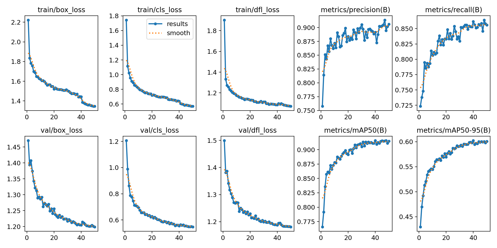
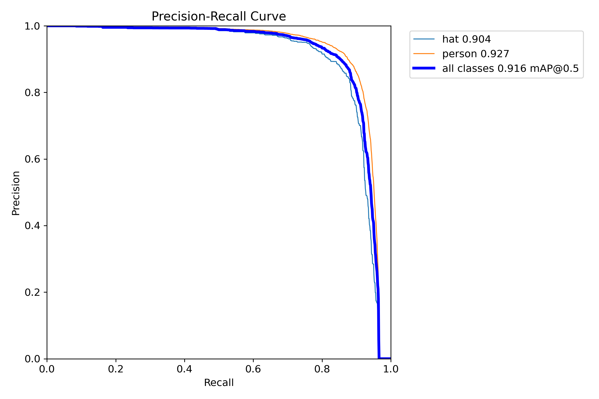
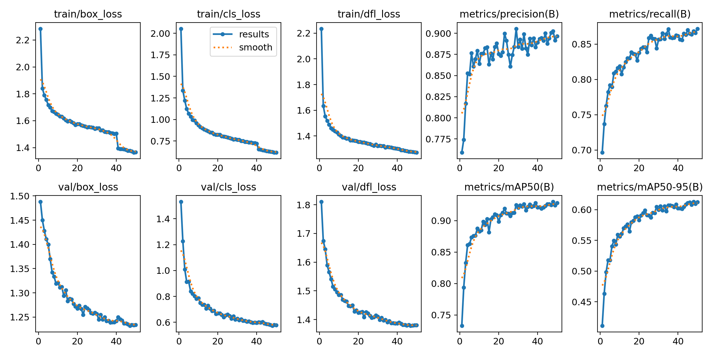
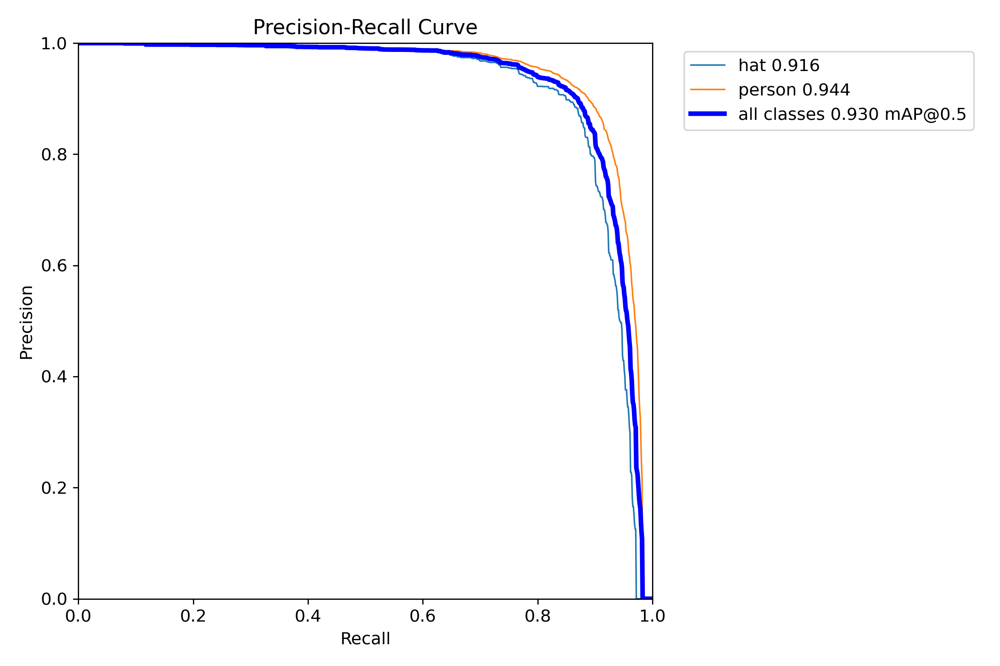

# 标准版与 P2：50轮训练验证结果

更新：2026-10-23。两版训练产物已收到，连续50轮CSV、best.pt校验值及权重内保存的指标一致。本报告提取已有训练验证结果，没有重新训练或重新推理。

## 主要结果

同一数据版本：train 6488 / val 511 / test 508，imgsz640。以下均为各自 **best.pt 对应轮次的验证指标**，不是把不同轮次的单项峰值拼在一起。

| 指标 | 标准版（第40轮） | P2（第48轮） | P2 − 标准版 |
| --- | ---: | ---: | ---: |
| Precision | 89.160% | 90.248% | +1.088个百分点 |
| Recall | 86.152% | 86.829% | +0.677个百分点 |
| mAP50 | 91.584% | 92.995% | +1.411个百分点 |
| mAP50–95 | 60.244% | 61.301% | +1.057个百分点 |

**本次运行的总体验证指标均更高，支持继续评估P2；尚不能称为稳定或纯粹由结构导致的提升。** P/R为训练验证器报告的工作点指标，不是固定conf=0.25的部署精确率/召回率；尚未统计小目标专门指标，不能把总体提升写成小目标AP提升。

第50轮（最后一轮）mAP50–95分别为60.064% / 61.246%，与最佳轮次区分记录。完整数值见[汇总JSON](summary.json)、[标准版CSV](standard/results.csv)、[P2 CSV](p2/results.csv)。

## 曲线

### 标准版

### P2

PR图中每类AP50约为：hat 0.904→0.916，person 0.927→0.944（图上三位小数）；person表示未戴帽头部。两类均出现正向变化，但这不是按目标尺寸分层的分析。

## 对照条件与核验

- 两份最佳权重的SHA256均与training_artifact.json匹配；权重内保存指标与CSV最佳mAP50–95轮次一致。
- 数据清单SHA均为 `5781ecdffa173010f539189b15565220f5e2ac597b5f8ea72f5cf7b1e8bf63e4`，与场景风险隔离版本一致。
- 两版共有层0..15、官方预训练SHA、共有参数SHA一致；已核实检测步长分别为8/16/32和4/8/16/32。
- 除模型/路径/输出名/resume等记录外，两份effective_train_args相同：50轮、batch2、640、AdamW、lr0=0.001667、seed0，以及相同增强配置。
- 标准版前13轮来自Mac MPS，随后CUDA续训，并记录在第31轮后再次恢复；P2记录为Windows CUDA训练。因此不能称为严格单变量消融，也不能认为同一个seed保证相同训练随机过程。
- 实际Windows环境记录为Python3.10.10、torch2.14.0+cu126、Ultralytics8.4.164；与最初迁移安装模板的Python/CUDA版本存在差异，以实际产物为准。标准版设备记录为RTX3060 Laptop 6GB；P2环境文件只确认CUDA设备0，没有单独保存GPU型号。

初始化、有效参数和环境见[标准版资料](standard/)及[P2资料](p2/)。原始路径与nvidia-smi进程列表在公开副本中移除；[原始文件校验值](source_sha256.json)说明原件与公开副本的区别。CSV及曲线原样复制。两份新权重保存在本地runs2，当前未发布为下载资产；仓库演示模型仍是历史版本。

## 数据治理也是一项已量化成果

在保持7507张接受图片及标签内容的情况下，调整491张分区，使20466对已检索关联候选的跨分区数量降到0。这是数据质量指标，独立于本页P2精度对比。[前后证据](../scene_isolation/README.md) · [旧、新标准版参数及数据变化](../baseline_evolution.md)。

## 为什么不直接宣称标准版超过旧模型

旧模型原测试集mAP50–95为57.087%，原验证集约61.448%；当前标准版是新511张验证集上的60.244%。旧划分存在重复泄漏，且评价图、训练图、初始化协议发生变化，不能相减得出模型提升或下降。旧模型也可能见过重新划分后的评价图片，不应把它在新划分上的结果当作独立基线。

## 下一步：使用已有权重，不重新训练

1. 在同一511张验证集，对两版固定普通推理640、conf0.25、NMS IoU0.7、max_det300；用相同类别内一对一匹配、匹配IoU0.5，统计TP/FP/FN、每类P/R/F1和逐图差异。NMS阈值与真值匹配阈值不同。
2. 事先固定尺寸分档：按原图框在640等比缩放后的短边，<8、8–16、16–32、≥32像素，分别报告目标数和召回，并区分hat/person。这是自定义分层召回，不称为COCO AP_small。核查新增正确检测、重复框及疑似标注缺失。
3. 固定硬件、精度和batch1，预热后重复计时，记录模型推理及端到端p50/p95。计时不含权重加载；另报图片解码/绘图的计时范围。CUDA峰值显存需在游戏本实测，不能用Mac内存代替。
4. 先在验证集决定结构、分辨率和阈值，冻结后再评价508张测试集。若测试集已被用于调参，应披露使用情况。若需要稳定性和严格因果结论，再考虑同硬件多种子补充训练，不是当前必须动作。

上述统一复评、分层召回和速度测试尚未执行，本次同步不填写这些结果。
