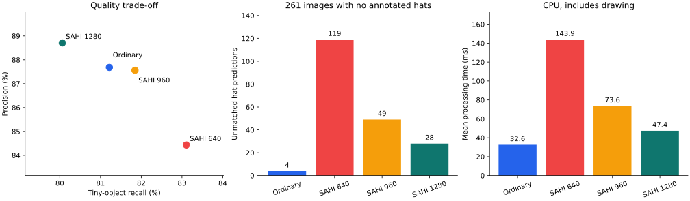
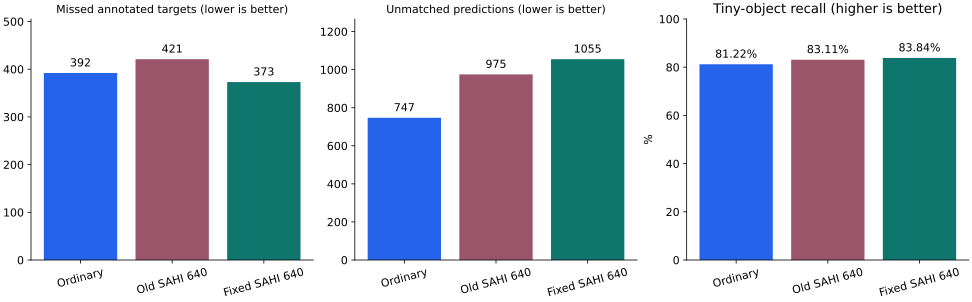

# SAHI 接入、切片消融与单块修复复验

[项目首页](../README.md) · [接入说明](../docs/SAHI.md) · [数字与复现文件](sahi_evaluation/)

**结论：当前模型与这批验证图片上，继续采用普通检测作为默认。** SAHI 对部分小目标有召回收益，但综合 F1 与未匹配预测数量更差；不把接入模块描述成已经取得整体性能提升。

## 已完成的工作

1. 在 Gradio 中接入普通 / SAHI 两种推理方式，共享同一个模型实例；固定640切片、20%重叠、额外整图预测与按类别合并，提供切片数量和耗时提示。
2. 对用户观察的 `PartB_01886.jpg` 做单图配对诊断，追踪切片原始预测与合并来源，确认新增的错误安全帽预测并非全部由框合并造成。
3. 在推理前冻结的529张原验证集筛查子集上，对比普通检测与640/960/1280切片；保留全部配置和逐图统计。
4. 离线重放定位单块图片额外合并造成的匹配下降，修复该分支，并完成33项代码回归检查。
5. 在相同529张图片上重新运行修正版SAHI 640，逐图核对小图与普通输出一致、大图与旧版SAHI一致，记录召回与错误预测的取舍。

没有重新训练或修改模型权重；检测网络来自 Ultralytics，SAHI 是推理策略，不是新增训练网络模块。

## 1. 单图观察：找到更多头部，也增加了错误安全帽预测

`PartB_01886.jpg`，3264×2448，74个标注均为未戴帽头部。相同模型、conf=0.25，640切片产生35块并补充整图预测：

| 方案 | 匹配 TP | 漏检 FN | 未匹配预测 FP | 最小档召回 |
| --- | ---: | ---: | ---: | ---: |
| 普通检测 | 59 | 15 | 5 | 75.00% |
| 旧版 SAHI 640 | 67 | 7 | 13 | 88.64% |

补回8个标注目标，其中6个属于最小档，同时新增8个hat预测。追踪得到14个原始hat预测全部来自切片；最终8个hat框中6个只有一个来源、2个经过合并，最大面积增幅约3.74%。因此，本例的大错误框不能全归因于合并。局部上下文、尺度变化或截断是待验证解释，不是已证明机制。

该图来自此前查看过的原测试子集，不纳入下面529张选参清单；单图结果不能代表整体表现。证据：[单图完整数值](sahi_evaluation/case04_summary.json)、[来源追踪结论](sahi_evaluation/case04_diagnosis.json)。

## 2. 数据选择与固定条件

从原验证集758张筛查到529张：排除7张训练字节重复、1张解码像素重复、2张已知冲突标注、218张感知近似训练候选、1张验证内部近似冗余。感知候选是保守排除，并非全部确认泄漏。名单在预测前冻结。

529张中223张仅hat、45张混合、261张仅person，共669个hat和5040个person标注。它与此前474张原测试筛查子集用途不同；不要把两批指标混为一个测试成绩。

- 历史权重 SHA256：`55be821e9eefdd0a69caf4abd3fdb2a22277059e21ec155222102b32cef2e650`。
- CPU，4个PyTorch线程、2个OpenCV线程；所有模型输入都是640，改变的是切片边长。
- conf=0.25，块内NMS IoU=0.7，max_det=300，rect=True，augment=False；重叠20%，多块补充整图预测，GREEDYNMM / IOS=0.5，按类别合并。
- 同类别、按置信度降序、一对一 IoU≥0.5 匹配，先匹配全部GT再按尺寸统计；difficult按普通目标计分。
- 最小档：原图最长边缩至640后，框面积平方根小于16；不是COCO AP_small。本页未计算mAP，P/R/F1是固定阈值下的目标微平均，不是最大F1点的类别平均。

原验证集参与过历史checkpoint选择；筛查尚未证明场景完全独立，原训练时期未保留不可变清单。本轮适用于探索参数和验证修复，**不是新独立泛化测试**。

证据：[529张清单与内容哈希](sahi_evaluation/selected_manifest.csv)、[758张筛查决策](sahi_evaluation/screening_decisions.csv)、[初轮协议](sahi_evaluation/slice_protocol.json)。

## 3. 原始切片尺寸对比

| 方案 | 召回率 | 最小档召回率 | Precision | 漏检 FN | 未匹配预测 FP | 微平均 F1 |
| --- | --- | --- | --- | --- | --- | --- |
| ordinary | 93.13% | 81.22% | 87.68% | 392 | 747 | 90.33% |
| sahi_640 | 92.63% | 83.11% | 84.43% | 421 | 975 | 88.34% |
| sahi_960 | 92.24% | 81.85% | 87.56% | 443 | 748 | 89.84% |
| sahi_1280 | 91.64% | 80.06% | 88.71% | 477 | 666 | 90.15% |



三种切片的整体F1均低于普通检测。640的最小档召回更高，但不能仅凭检测框增加或某一张图变好断言整体改进。置信度阈值固定，本轮没有寻找每种方案的最佳阈值。

证据：[完整汇总](sahi_evaluation/slice_summary.json)、[529×4逐图统计](sahi_evaluation/slice_per_image.csv)、[运行版本](sahi_evaluation/slice_run_identity.json)、[原轮核验](sahi_evaluation/slice_validation.json)。

## 4. 单块问题定位与修复

旧实现即使图片只产生一块，也会在YOLO的NMS之后执行一次SAHI合并。对保存的普通预测重放相同合并，可在绝对容差0.01内复现所有单块SAHI输出：640配置有231张单块图，净丢失48个匹配；960配置347张，净丢失60个；1280配置454张，净丢失85个。

修复后，用户选择SAHI时，只有一块的图片直接使用普通推理与绘图；多块图片继续原来的切片流程。网页会说明“图片无需切片，已按普通检测处理”。这是尺寸判断，不是判断哪个模型效果更好的智能选择器。

证据：[额外合并重放](sahi_evaluation/single_tile_postprocess_diagnosis.json)、[当前实现](../helmet_inference.py)、[回归检查](../tests/test_helmet_inference.py)、[修复检查记录](sahi_evaluation/code_fix_validation.json)。修复记录中的 `full_529_comparison_run=false` 指代码修复当时仅做回归检查；后续整批实跑结果见下一节。

## 5. 修正版529张实跑

| 方案 | 召回率 | 最小档召回率 | Precision | 漏检 FN | 未匹配预测 FP | 微平均 F1 |
| --- | --- | --- | --- | --- | --- | --- |
| 普通检测 | 93.13% | 81.22% | 87.68% | 392 | 747 | 90.33% |
| 旧版 SAHI 640 | 92.63% | 83.11% | 84.43% | 421 | 975 | 88.34% |
| 修正版 SAHI 640 | 93.47% | 83.84% | 83.49% | 373 | 1055 | 88.20% |



普通检测和旧版SAHI复用上轮冻结预测；本轮实际重跑修正版的全部529张，而不是用旧统计推算。相对旧版补回48个标注匹配、没有丢失旧正确匹配，同时新增80个未匹配预测；F1从88.34%略降至88.20%。相对普通检测补回82个、丢失63个，净多匹配19个，但多出308个未匹配预测，F1低2.13个百分点。

231张单块图片均恢复普通检测输出；298张多块图片均保持旧版SAHI640输出，计数重新计算一致。去掉额外合并会同时恢复部分正确框和未匹配框，所以不能预期只增加正确目标。

**FP表示未匹配预测**，可能是背景误识别、重复框、类别错误、定位偏差或漏标；本轮没有对所有FP完成逐个原因确认。

| 方案 | hat Precision | hat Recall | hat FP | 261张无hat标注图的hat预测 | 出现此预测的图片数 |
| --- | --- | --- | --- | --- | --- |
| 普通检测 | 90.79% | 91.33% | 62 | 4 | 4 |
| 旧版 SAHI 640 | 70.36% | 91.18% | 257 | 119 | 34 |
| 修正版 SAHI 640 | 70.29% | 91.93% | 260 | 119 | 34 |

“无hat标注”图仍含person，不是纯背景图；标签遗漏仍可能影响统计。最小档指标包含两种头部；修复前后最小档hat召回仍为25/51，不能把整体最小档提升都写成小安全帽提升。大图切片引起的安全帽错误预测尚未解决。

证据：[完整修复复验汇总](sahi_evaluation/fix_summary.json)、[529×3逐图对照](sahi_evaluation/fix_per_image.csv)、[复验协议](sahi_evaluation/fix_protocol.json)、[逐图等价核验](sahi_evaluation/fix_validation.json)。JSON中保存了探索性的图级配对bootstrap区间；场景独立性未证明，不能据此宣称正式泛化或显著性结论。

## 6. 耗时与工程取舍

初轮普通、640/960/1280的平均处理耗时约32.6/143.9/73.6/47.4ms；本轮修正版640为141.8ms。均为CPU，包含绘图等处理，不含输入读取、上传及浏览器传输。修正版与旧版来自不同运行时刻，不能据此给出严格修复加速比；单图诊断使用8个线程，整批使用4个，不能直接混比。

决定：保留普通检测默认，SAHI作为已评估的可选方式；保留单块分支修复及完整负面结果，暂停继续堆叠SAHI参数。后续优先围绕普通检测的标注质量、漏检和任务相关负样本建立可验证假设。

## 7. 如何复现

仓库提供数字、名单、图片/标签哈希和推理代码；不重新分发SHWD原图、原标注文件或本地图片对照页。数据来源：[SHWD](https://github.com/njvisionpower/Safety-Helmet-Wearing-Dataset)。需自行准备与清单哈希一致的历史验证图片及YOLO标签，保留 `images/val`、`labels/val` 结构。重新随机划分后的750张验证图不能替代这份清单。

在仓库根目录、已激活项目环境后：

```bash
python -m pip install -r requirements-gradio.txt
python download_weights.py
python reports/sahi_evaluation/reproduce.py --data-root helmet_dataset --output error_analysis/sahi_reproduction
```

只运行当前修正版：

```bash
python reports/sahi_evaluation/reproduce.py --data-root helmet_dataset --configs sahi_640_fixed --output error_analysis/sahi_fixed_reproduction
```

输出目录必须不存在；脚本不覆盖已有结果。`--limit 3`仅供流程检查，会明确标为子集检查。复现环境要求与原记录一致的Python3.14.7、PyTorch2.14.0、Ultralytics8.4.164、SAHI0.12.8；当前依赖快照来自Mac，不保证其他系统完全兼容。

复现入口在发布整理时新增，不冒充当时执行脚本；已用前三张、五种配置逐框和逐项计数与原记录核对。旧合并行为的源文件单独冻结在 [legacy_inference.py](sahi_evaluation/repro/legacy_inference.py)，评价函数从原实验原样提取；当前修正版复用项目正式入口。新运行输出与已公开历史数字分开保存。

[文件来源清单](sahi_evaluation/artifact_manifest.json)记录原始本地文件SHA256和公开文件SHA256。公开副本仅将个人绝对路径改为相对路径并整理格式，数值保持不变；原始完整预测日志保留本地，哈希见验证记录。公开资料包含逐图计数和全部汇总，不声称已上传全部原始预测框。
