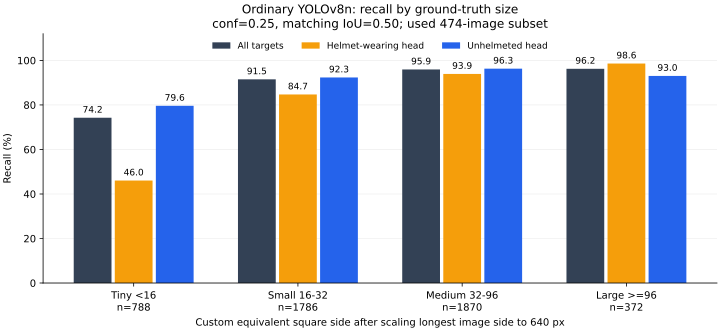

# 第一步：普通检测的小目标与错误统计

本次沿用原模型，对原测试集事后筛查保留的 **474 张图片、4,816 个标注目标**进行固定阈值诊断。没有训练，也没有进行 SAHI 精度比较。模型、图片与标签哈希在运行前后核对一致。

## 先看结论

按现有标注，普通检测共漏检 **445** 个目标，其中最小两档贡献 **355 个（79.8%）**，而这两档只占全部标注目标约 **53.4%**。最小档召回率约 **74.24%**，中、大档约 **96%**，支持优先研究微小目标问题。

最小档戴帽头部仅检出 **58 / 126** 个，召回率 **46.03%**。这是当前数据上的诊断线索，不能直接断言尺寸是唯一原因；类别、画质、遮挡和标注质量可能同时影响结果。



## 大小与类别统计

大小定义：先假设将原图最长边等比例缩放到 640，再计算标注框面积的平方根，即面积等效边长。四档为 <16、16–32、32–96、≥96 像素。这是本项目自定义口径，不是 COCO AP_small。本次最小档按面积定义；此前“宽高都小于16”的629个统计使用另一口径，不能直接比较。

| 目标档位 | 标注数 | 检出 TP | 漏检 FN | 召回率 |
| --- | ---: | ---: | ---: | ---: |
| 最小 <16 | 788 | 585 | 203 | 74.24% |
| 较小 16–32 | 1786 | 1634 | 152 | 91.49% |
| 中等 32–96 | 1870 | 1794 | 76 | 95.94% |
| 较大 ≥96 | 372 | 358 | 14 | 96.24% |

| 类别 | 标注数 | 检出 TP | 漏检 FN | 疑似误检 FP | Precision | Recall |
| --- | ---: | ---: | ---: | ---: | ---: | ---: |
| hat | 816 | 698 | 118 | 135 | 83.79% | 85.54% |
| person | 4000 | 3673 | 327 | 549 | 87.00% | 91.83% |

总体：TP=4,371、FN=445、FP=684、预测框=5,055；按目标汇总的微平均 Precision=86.47%、Recall=90.76%。没有图片触及 max_det=300 上限。

FP/FN 都是相对于现有标注的程序判定。漏标也会产生“疑似误检”，错误标注也可能产生“漏检”。不能将所有 FP 直接解释为模型识别了背景。

## 如何计分

- 普通整图预测，CPU、imgsz=640、batch=1、conf=0.25、NMS IoU=0.7、max_det=300、rect=True、augment=False。单图执行与当前网页普通检测方式一致。
- 预测按置信度从高到低排序；只与同类别、尚未匹配的标注框匹配，IoU≥0.5 算 TP。一个标注只能匹配一次，重复框不会重复计分。
- 先在全部标注上完成匹配，再按标注大小统计 TP/FN，防止先筛小目标造成匹配错误。
- difficult 继续作为普通目标。按大小只报告 Recall；FP 没有真实标注大小，不给出混淆口径的“各档 Precision”。
- 当前是固定阈值、微平均、自定义匹配诊断。与此前低候选阈值计算 mAP、最大平均 F1 点的类别平均 P/R 不同，不能把数值差异称为模型提升或退化。本次没有计算 AP。

## 下一步人工核查

本地生成了20组“原图 / 标注 / 预测”对照，按微小漏检、较小漏检、疑似误检、分类候选四组各取5张，不是随机代表样本。图片保留在本地，不随报告上传。

先看第1–5张：确认红色标注框是否对应可辨认的头部，再看模型有没有漏掉。接着看疑似误检：红色预测框也可能对应漏标目标。记录“微小、遮挡、模糊、分类、定位、疑似漏标或不确定”，暂不修改原始标签。

首次四类预览可看到密集人群、模糊背景和待核查的分类/标注关系；这只是视觉观察，没有对全部错误完成原因归类，不能报告“遮挡占多少”等未标注属性的比例。人工核查仍待完成。

## 文件与复现

- [脚本](../analyze_detection_errors.py) · [匹配与完整性检查](../tests/test_error_analysis.py)
- [协议与模型/数据/脚本哈希](small_object_analysis/protocol.json)
- [总体、每类及每档完整数值](small_object_analysis/summary.json)
- [逐图统计](small_object_analysis/per_image.csv) · [逐个标注的 TP/FN](small_object_analysis/ground_truth_outcomes.csv)
- [验证状态](small_object_analysis/validation.json)

需要已有原测试筛查副本及保留清单，生成方法见[旧测试复评](legacy_test_reassessment.md)。本脚本当前限定474张协议，输出目录不能已存在：

```bash
python analyze_detection_errors.py \
  --data-root /你的/旧测试复评/dataset \
  --manifest /你的/旧测试复评/retained_test_manifest.csv \
  --model /你的/模型/best.pt \
  --model-sha256 55be821e9eefdd0a69caf4abd3fdb2a22277059e21ec155222102b32cef2e650 \
  --output error_analysis
```

8项新增匹配与完整性检查通过，覆盖重复预测、错分类、拥挤场景、一对一匹配、空结果、尺寸分档和标签变化。

## 结果适用范围

该集合已被用于复评，是事后诊断数据。原数据划分的泄漏、未完全验证的场景独立性和标注疑问仍适用。本文支持选择下一步实验方向，不能作为全新独立泛化结论，也不证明 SAHI 有收益。
